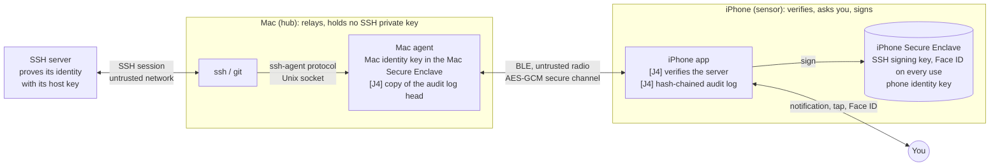
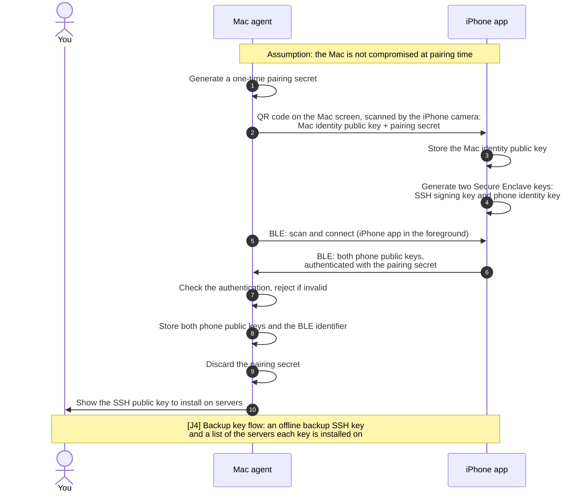
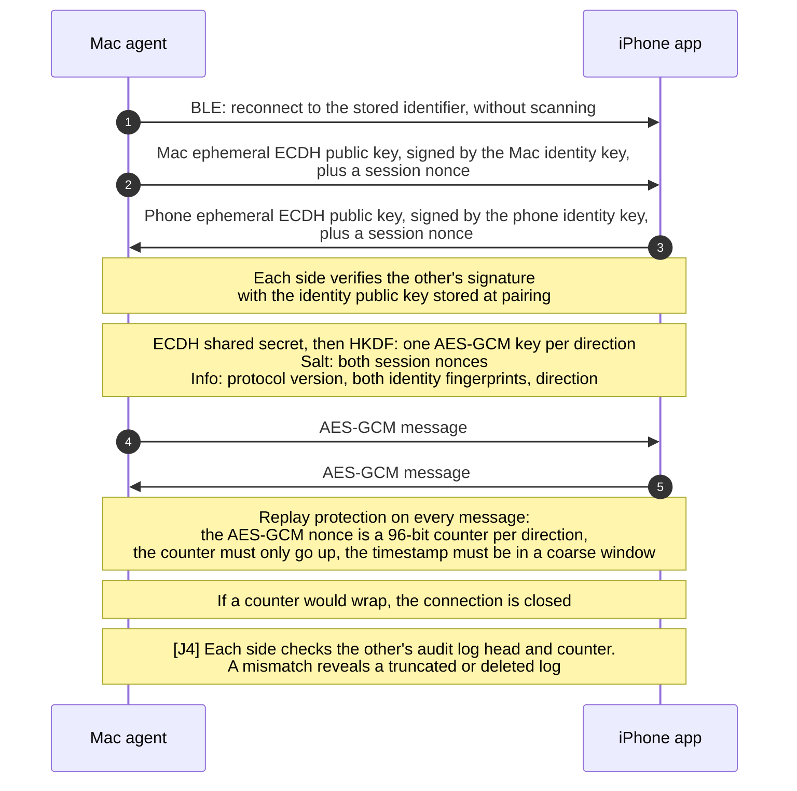
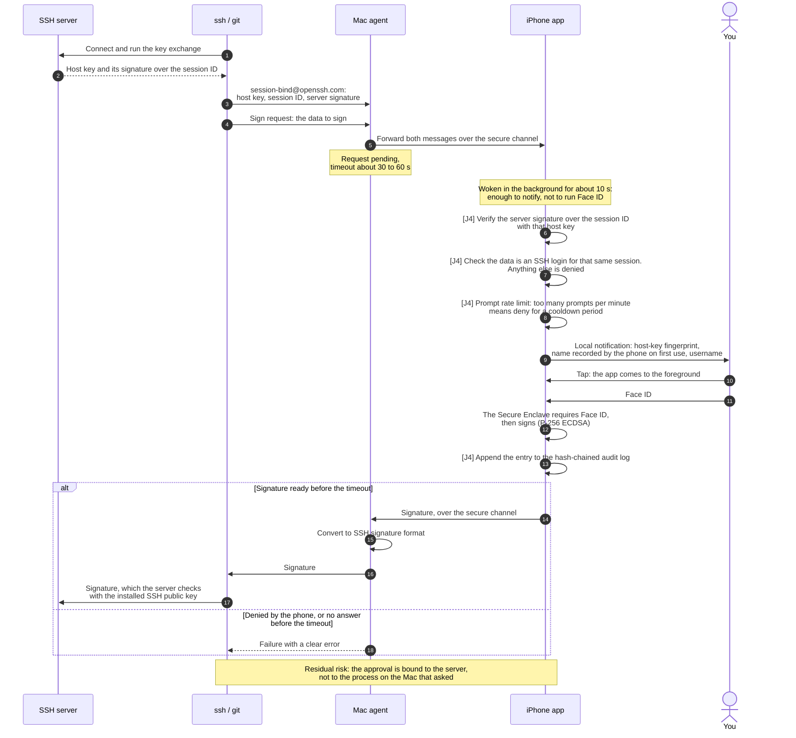

# SentryKey flow diagrams

Diagrams of the flows described in [ARCHITECTURE.md](ARCHITECTURE.md). If the two disagree, ARCHITECTURE.md is the reference. GitHub renders the Mermaid blocks below.

**Names used in every diagram:** *Mac agent* (the macOS menu bar app), *iPhone app*, *ssh / git* (the OpenSSH client on the Mac), *SSH server* (any server, including GitHub), *You*.

**Milestone tags:** a step tagged `[J4]` is not in the J3 MVP. A step tagged `[Stretch]` is optional. Untagged steps are in the J3 MVP.

**"Not specified":** where ARCHITECTURE.md is silent, the diagram leaves the step out and the text below it says so.

## 1. Overview and trust boundaries

The SSH private key exists only in the iPhone's Secure Enclave. The Mac relays requests and holds no SSH private key. The phone decides, and it does not trust the Mac or the Bluetooth link about which server is asking.

| Element | Trusted for | Not trusted for |
|---|---|---|
| iPhone Secure Enclave | Keeping the SSH signing key and requiring Face ID for every signature | |
| iPhone app | Verifying the server, showing it to you, keeping the audit log | |
| Mac agent | Being honest at pairing time (stated assumption). Relaying messages | Naming the server. From J4 the phone ignores any host name from the Mac. A compromised Mac cannot sign without the phone and your face |
| BLE radio and local network | Nothing | Everything. All messages after the handshake are AES-GCM protected |
| SSH server | Identified by its host-key fingerprint, which the phone checks itself (J4) | |

**Residual risk (see diagram 4):** your approval is bound to the server, not to the process on the Mac that asked. Malware on the Mac can still obtain one signature for a server you approve.

**Not drawn:** the offline backup SSH key. It is generated at setup and kept on paper or another device, away from both the Mac and the phone.

## 2. Pairing (once, both devices in hand)

The QR code is the out-of-band channel. It authenticates the Mac's identity public key to the phone. The one-time pairing secret inside it lets the Mac check that the public keys it receives over BLE come from the phone that scanned the QR code: an attacker in the middle who swaps the keys cannot authenticate them without the secret.

- Only public keys cross between the devices. The private keys never leave their Secure Enclave.
- The Mac scans for the phone only here. iOS hides advertised services from non-iOS scanners when the app is in the background, so later connections use the stored BLE identifier (diagram 3).
- **Not specified in ARCHITECTURE.md:** the exact construction that authenticates the phone's keys with the pairing secret, how long the QR code stays valid, and where the backup key is generated.

## 3. Secure channel (every BLE connection)

Each side signs a fresh ECDH key with its identity key, so each connection gets new keys (forward secrecy). The signatures authenticate the Mac and the phone to each other with the public keys exchanged at pairing. Every later message is authenticated by AES-GCM under keys derived from this handshake, which is how the design meets "every message is signed".

- The Mac is the BLE central. It reconnects with `retrievePeripherals(withIdentifiers:)` + `connect()`, which never times out, and repeats this after every disconnection.
- **Not specified in ARCHITECTURE.md:**
  - Which side sends its handshake message first. The diagram shows the Mac first only because the Mac opens the BLE connection.
  - Exactly which fields each identity signature covers. The document says each side signs its ephemeral key. The session nonces exist (they feed the HKDF salt), but the document does not say whether they are signed.
  - What happens when a signature check fails, the size of the timestamp window, and what each side does when the audit log heads do not match.

## 4. Signing (every `ssh` login or `git push`)

A `git push` over SSH is an SSH login, so it follows this flow. The phone checks the server itself from J4 on. One Face ID gives exactly one signature.

**J3 MVP difference:** steps tagged `[J4]` are absent. The phone shows the host reported by the Mac and labels it "unverified". Face ID on every signature is already enforced in J3.

**What the phone trusts.** It uses only the host key, the session ID and the server's signature from `session-bind`, and the data to sign. It ignores any host name from the Mac. The name it shows is the one it recorded itself for that host-key fingerprint.

**Residual risk.** Malware on the Mac can open its own connection to a server you are about to approve and receive the signature. Each attempt needs a fresh Face ID approval from you, and it only works for servers you already use.

**Other points from ARCHITECTURE.md:**
- `[Stretch]` The phone also accepts a git commit signature (SSHSIG with the `git` namespace) as data to sign.
- The audit log entry records the time, the host-key fingerprint, the username, the decision and the hash of the previous entry.
- If the phone cannot be woken (force-quit, Bluetooth off, not unlocked since reboot), the Mac shows "Phone unreachable: open SentryKey".
- Open question to prototype first: whether the Mac can reliably wake the backgrounded app over BLE.

**Not specified in ARCHITECTURE.md:**
- The order of the phone's checks and the rate limit, and the exact limits.
- Whether the phone sends an explicit denial to the Mac or lets the request time out, and whether denied requests are written to the audit log.
- What the phone shows for a host-key fingerprint it has never seen, and where the recorded name comes from.
- What happens when Face ID fails or you dismiss the notification.
- When the phone sends the new audit log head to the Mac.
