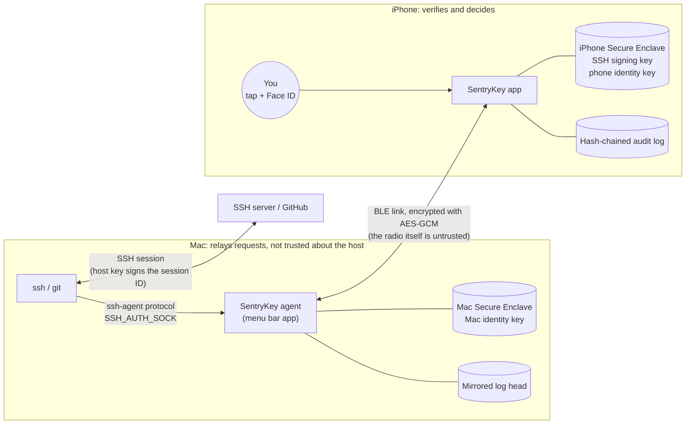
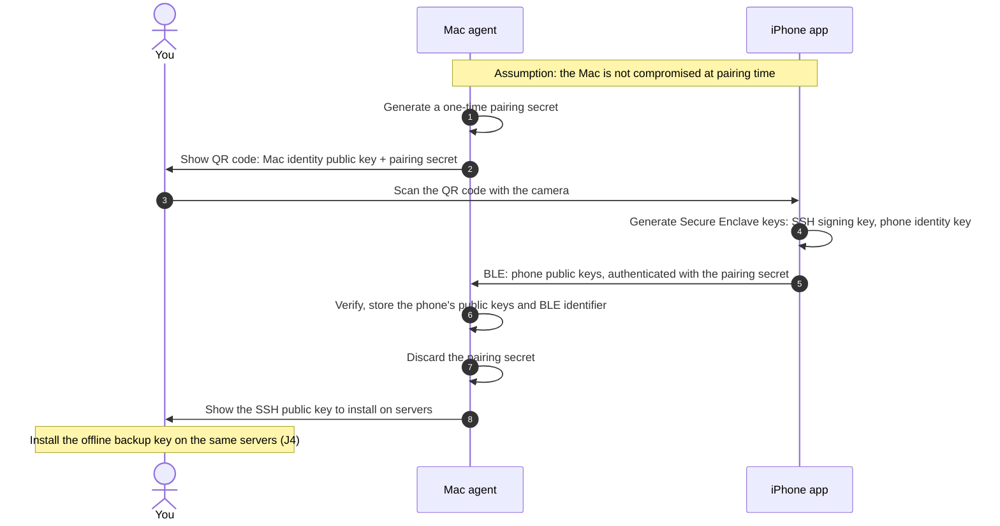
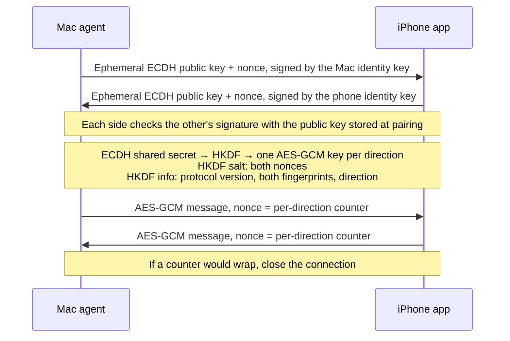
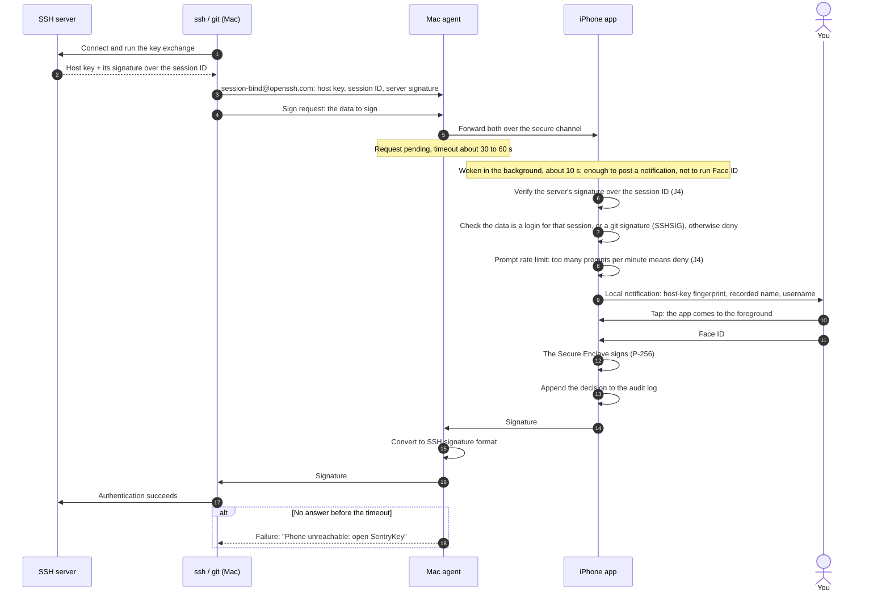

# SentryKey flow diagrams

Diagrams of the flows described in [ARCHITECTURE.md](ARCHITECTURE.md). If the two disagree, ARCHITECTURE.md is the reference. GitHub renders the Mermaid blocks below.

## 1. Overview and trust boundaries

The iPhone decides. The Mac and the Bluetooth link only carry messages, and the phone does not trust them about which server is asking.

## 2. Pairing (once, both devices in hand)

The QR code is the out-of-band channel: it proves the Mac's key to the phone, and the one-time secret lets the Mac check that the phone's keys came from the phone that scanned it.

## 3. Secure channel (every BLE connection)

Both sides sign a fresh ECDH key with their identity key, so each connection gets new keys (forward secrecy). Every later message is authenticated by AES-GCM under those keys.

## 4. Signing (every `ssh` login or `git push`)

**J3 MVP difference:** before session-bind verification lands in J4, the phone shows the host name reported by the Mac and labels it "unverified".
