# SentryKey red team guide

Working notes for whoever holds the red team role at the current milestone. The role rotates, so this file is written to be picked up cold.

It contains three things:

1. A model of the system and of the attackers we consider.
2. A primer on the transport, limited to what matters for attacking SentryKey: the local network by default, Bluetooth Low Energy as an option (appendix A).
3. Decision trees: for each part of the system, the questions to ask about the implementation and the attack to try for each answer.

Scope: our own app, our own devices, and at J4 the other group's app with their agreement. Nothing here is to be run against devices or networks that are not ours.

**Status:** there is no code yet. Every tree is written against the design in the root `README.md`. Items marked **[verify]** are claims about Apple or OpenSSH behaviour that nobody on the team has confirmed on a real device or in the documentation. Confirm them before writing them into a report.

**Known gap:** this guide was written against `main`. Pull request #1 adds `docs/ARCHITECTURE.md`, which differs from what is assumed here on three points: Bluetooth is the transport, every signature requires Face ID, and automatic approval is out of scope. Until the guide is aligned, read appendix A and the Bluetooth diagram of T3 as the main transport material, and treat the automatic-approval branches of T4 and T5 as not applicable.

**Scope, as reported to the red team on 2026-11-23:**

- SentryKey signs **SSH user authentication only**. `git push` over SSH is in scope because it is an SSH authentication. Signing git commits or arbitrary files with the key is out of scope, and the app refusing such requests is something to test (T4.2).
- The transport is the **local network**. **Bluetooth is optional.** Bluetooth-specific material is in appendix A and in the Bluetooth diagram of T3 (attacks T3.B1 to T3.B6).

## 1. System model

```
            Mac (untrusted host)                         iPhone (trusted device)
 ┌──────────────────────────────────────┐        ┌──────────────────────────────────┐
 │ ssh / git                            │        │ SentryKey app                    │
 │    │  agent protocol                 │        │   channel  ── policy engine      │
 │    ▼  (unix socket, SSH_AUTH_SOCK)   │  LAN   │                │                 │
 │ SentryKey agent ── channel ══════════╪════════╪══► channel     ▼                 │
 │    │                                 │        │           Secure Enclave (P-256) │
 │ Mac identity key, pairing record     │        │   signed, hash-chained log       │
 └──────────────────────────────────────┘        └──────────────────────────────────┘
        boundary 1: socket      boundary 2: network      boundary 3: app ↔ enclave
```

### Assets

| ID | Asset | Where it lives | What losing it means |
|---|---|---|---|
| AS1 | SSH private key | iPhone Secure Enclave | Not extractable by design. The realistic loss is *use*, not theft. |
| AS2 | Ability to obtain a signature | The whole chain | An attacker logs in to our servers or pushes to our repositories. This is the asset that matters. |
| AS3 | Mac identity key and pairing record | Mac | Whoever holds it is "the Mac" to the iPhone. |
| AS4 | Session keys | Memory on both sides | Read and forge channel traffic. |
| AS5 | Decision log | iPhone | Lose the ability to prove what was approved. |
| AS6 | Metadata: host names, times, user names | Channel, log, console | Privacy leak, and a map of our infrastructure. |

### Attackers

| ID | Attacker | Capability |
|---|---|---|
| AT1 | Malware on the Mac | Runs as the logged-in user. Reads the user's files, connects to the user's sockets, starts processes. This is the attacker the project exists to stop. |
| AT2 | Network attacker | On the same Wi-Fi. Listens, injects, redirects traffic, announces fake services, connects to any open port. |
| AT3 | Relay pair | Only if Bluetooth is built. Two radios, one near the iPhone and one near the Mac, forwarding traffic between them. |
| AT4 | Phone thief | Holds the iPhone, locked or unlocked. |
| AT5 | Mac thief | Holds the Mac, locked or unlocked, without the iPhone. |
| AT6 | Malicious server | A host we connect to with agent forwarding enabled. |
| AT7 | The legitimate user | Denies having approved something. |

### Which tree to open

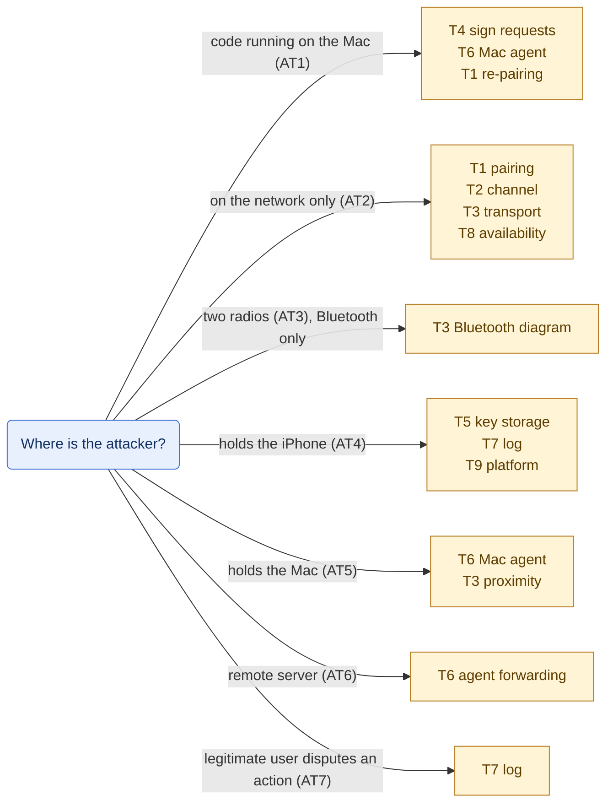

## 2. Local network primer

The default transport is the one from the brief's reference architecture: iPhone and Mac on the same Wi-Fi, talking directly to each other. The brief states that this network is not trusted.

### 2.1 Connection

- One side opens a listening port, the other connects to it, usually over TCP. On Apple platforms this is Network.framework: `NWListener`, `NWConnection`, `NWBrowser`.
- **Design question for the team:** which side listens? A listener is reachable by every device on the network, so the listening side carries the exposure (tree T3).

### 2.2 Discovery

- **Bonjour** (mDNS + DNS-SD) is how the two devices find each other without a fixed address. A device announces a service type, for example `_sentrykey._tcp`, by multicast. Every device on the network receives the announcement.
- Announcements are not authenticated. Any device can announce the same service name.
- The alternative is to put an address and port in the pairing QR code. It goes stale when the address changes.
- Either way, discovery only says where to connect. It proves nothing about who answers.

### 2.3 What a device on the same network can do

- **Listen.** On an open network, to everything. On a network with a shared password, to other clients' traffic once it has captured their connection handshake.
- **Redirect.** ARP spoofing makes the victim send its traffic through the attacker. A fake Bonjour answer does the same at the discovery level.
- **Impersonate the network.** An access point with the same name and a stronger signal attracts clients.
- **Connect** to any listening port, and send anything.
- Consequence: same as for any transport, all confidentiality and authentication come from the application channel (ECDH + HKDF + AES-GCM). If a security property depends on the Wi-Fi being private, that is a finding.

### 2.4 Framing

- TCP delivers a stream of bytes with no message boundaries. One send can arrive in several pieces, and several sends can arrive glued together.
- The app must define its own framing, typically a length prefix followed by the message.
- That framing code parses attacker-controlled input before any authentication has happened, which makes it a prime target (T3.9).

### 2.5 iOS specifics that shape the attack surface

- **Local network permission.** iOS asks the user before the app may talk to local devices. The app declares `NSLocalNetworkUsageDescription` and its Bonjour service types in `Info.plist`. Recent macOS versions have a similar prompt for the agent. **[verify]**
- **Background execution.** iOS suspends an app shortly after it leaves the foreground, and its sockets stop being serviced. A free account has no push notifications to wake it. Over the local network, the app probably has to be open on screen to answer a request. This is the riskiest assumption behind the zero-touch goal. **[verify]**
- **Locked phone.** Same limit, plus the key protection class (tree T5).
- **Networks that block device-to-device traffic.** Guest, school and corporate Wi-Fi often isolate clients. Nothing to attack, but the demo fails. A personal hotspot is the usual workaround.

### 2.6 Proximity

- Being on the same network does not mean being near. Campus networks span buildings, and a VPN puts a remote machine on the local network.
- A network name is not an identity. Anyone can create a network with the same name.
- Without Bluetooth there is no proximity signal at all. Any policy rule that says "auto-approve when the phone is nearby" has to be dropped or redefined, and the red team should ask which.

### 2.7 Tools

| Tool | Use |
|---|---|
| Wireshark, `tcpdump` | Capture traffic on our own machines. Check that nothing readable crosses the network. |
| `dns-sd -B` | Browse Bonjour services. See what the app announces. |
| `nc` | Connect to the listener by hand and send arbitrary bytes. First tool to reach for. |
| A second Mac running our own code | The simplest fake agent or fake iPhone. |
| Bettercap | ARP and mDNS spoofing, on our own network only. |

Adding any of these to the repository as a dependency follows the vetting rule in `CONTRIBUTING.md`.

## 3. Decision trees

How to read them:

- Each tree is one or more diagrams followed by a table.
- **Blue** boxes are questions about the implementation. Answer them by reading the code or by testing. The answer is on the arrow.
- **Red** boxes are attacks to try. The ID (for example `T1.3`) is what a finding report cites. The table under the diagram says exactly what to do.
- **Green** boxes are the secure answer. Still confirm it with a test.
- **Yellow** boxes are things to report or a pointer to another tree.
- STRIDE letters in the tables: **S**poofing, **T**ampering, **R**epudiation, **I**nformation disclosure, **D**enial of service, **E**levation of privilege.

### T1. Pairing

Authenticating the two keys:

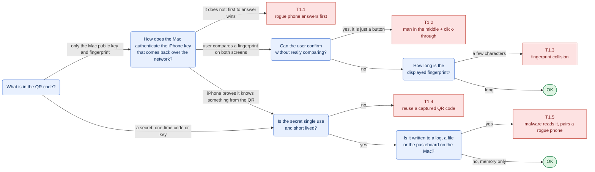

Pairing lifecycle:

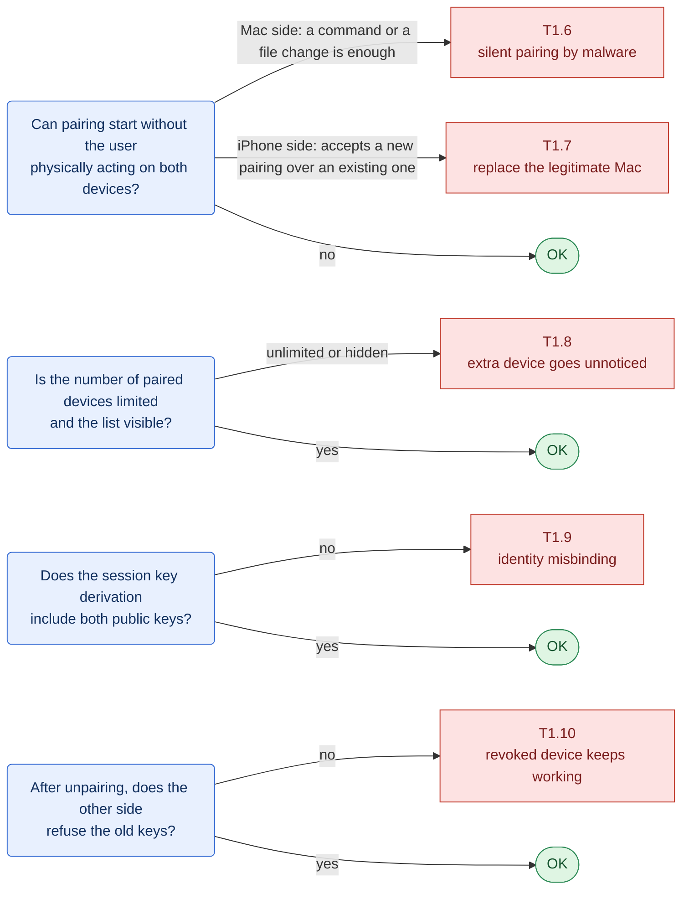

| ID | STRIDE | Attack |
|---|---|---|
| T1.1 | S | Answer the pairing from a second phone before the real one does. |
| T1.2 | S | Sit in the middle during pairing and rely on the user clicking through. |
| T1.3 | S | Generate keys until the truncated fingerprint collides with the real one. |
| T1.4 | S | Reuse a photographed or logged QR code later. |
| T1.5 | I | As AT1, read the secret from where the Mac wrote it, then pair a rogue phone. |
| T1.6 | E | As AT1, start a pairing silently and enrol an attacker phone. |
| T1.7 | S | Send a pairing request to an already paired iPhone and replace the legitimate Mac. |
| T1.8 | E | Enrol one more device and check that nobody notices. |
| T1.9 | S | Make each side believe it is talking to someone else, because the keys are not bound into the session. |
| T1.10 | E | Unpair, then keep using the old keys. |

### T2. Application channel

Keys and nonces:

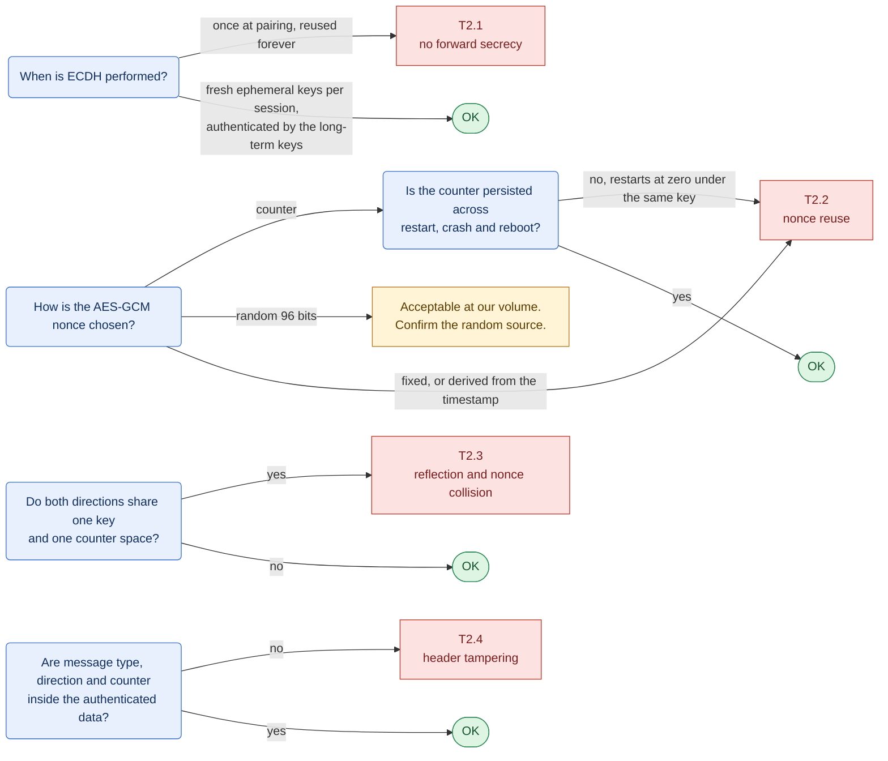

Replay and error handling:

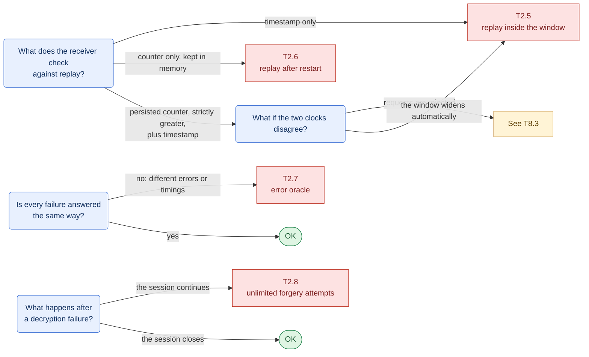

| ID | STRIDE | Attack |
|---|---|---|
| T2.1 | I | Steal a long-term or session key once (AS3 or AS4), then decrypt traffic recorded earlier. |
| T2.2 | I, T | Force a restart and capture two messages sent with the same nonce. Nonce reuse in GCM breaks both confidentiality and authenticity. |
| T2.3 | T | Send a message back to its sender, and look for the same nonce used in both directions. |
| T2.4 | T | Change the header of a captured message and check whether it is still accepted. |
| T2.5 | T | Replay a message inside the tolerance window. Measure how wide the window is. |
| T2.6 | T | Restart the receiver, then replay an old message. |
| T2.7 | I | Compare responses to a bad tag, a bad counter and a bad format to learn what is checked first. |
| T2.8 | T | Send forged messages repeatedly on one session. The session should close at the first failure. |

### T3. Transport and proximity

Everything here applies to the local network transport. The Bluetooth diagram at the end applies only if that transport is built. Read appendix A first.

Listener and discovery:

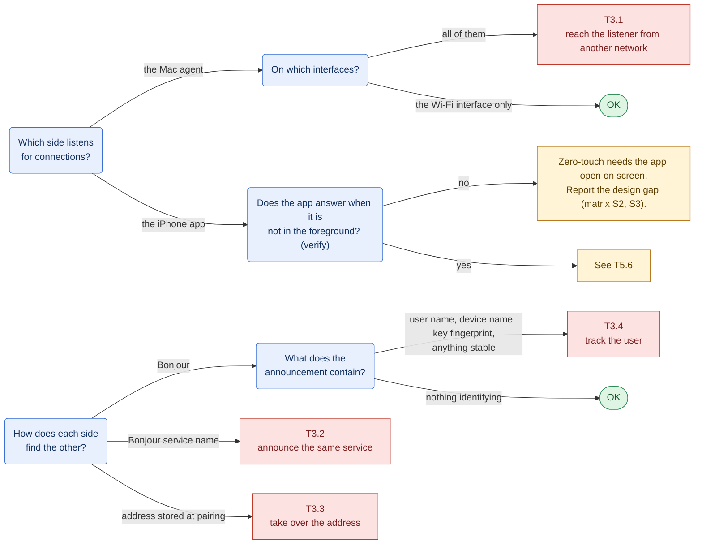

On the wire:

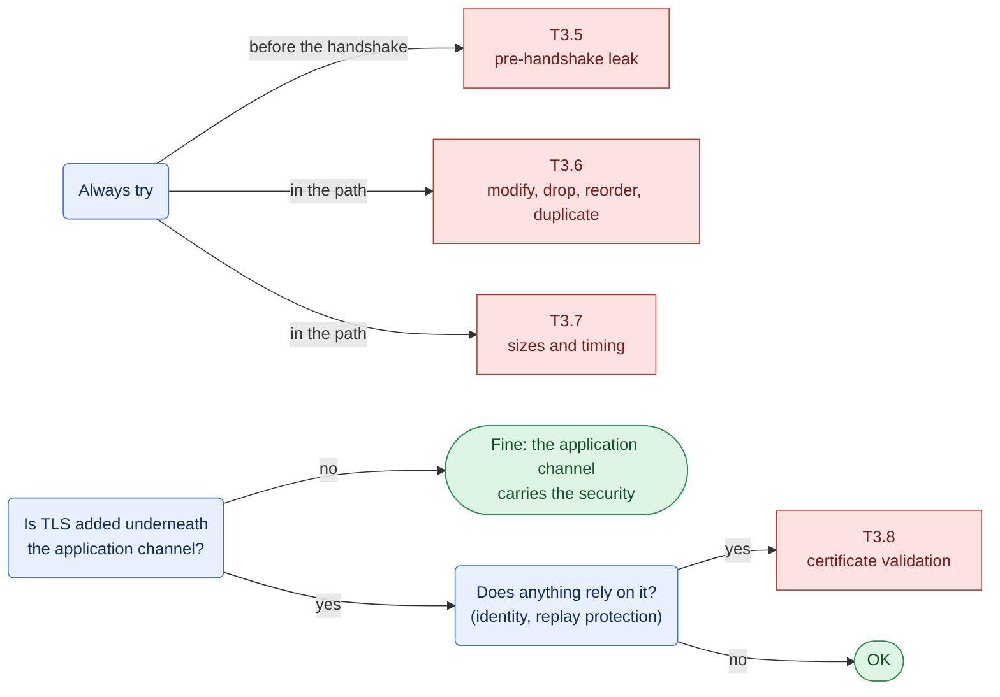

Parsing and connections:

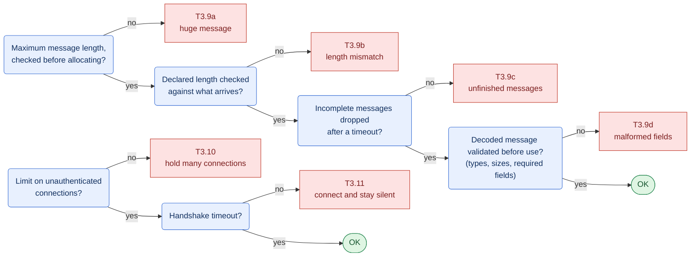

Location and proximity:

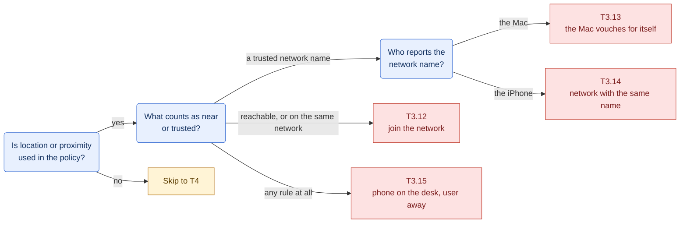

Bluetooth (optional):

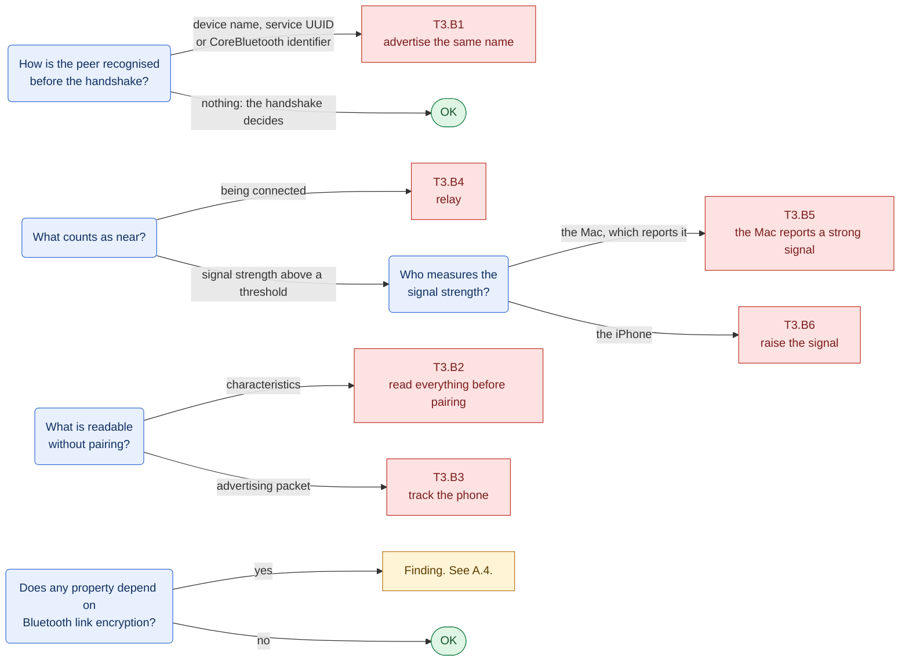

| ID | STRIDE | Attack |
|---|---|---|
| T3.1 | E | Reach the listener from another network: VPN, hotspot, second interface. |
| T3.2 | S | Announce the same Bonjour service from another machine. Expected: connection, then failure at the channel handshake. Anything more is a finding. |
| T3.3 | S | Take over the stored address with ARP spoofing. Same expected result. |
| T3.4 | I | Identify and follow the user from what the announcement contains. |
| T3.5 | I | Connect with `nc`. Record what the peer sends unprompted and how it answers garbage. Anything beyond handshake material is a leak. |
| T3.6 | T | From the path (ARP spoofing, fake access point), modify, drop, reorder and duplicate packets. Expected: the session closes and nothing is accepted. |
| T3.7 | I | From the path, record sizes and timing. Note what they reveal: when the user connects, to how many hosts. |
| T3.8 | S | Present a wrong certificate. Accepting any certificate is the usual AI-generated shortcut. |
| T3.9a | D | Announce a huge message and exhaust memory. |
| T3.9b | T | Send short, extra, zero-length and split messages. |
| T3.9c | D | Start many messages and never finish them. |
| T3.9d | T | Send malformed fields, wrong types, empty or oversized strings. |
| T3.10 | D | Hold many connections open and see whether the real peer is starved. |
| T3.11 | D | Connect and stay silent. |
| T3.12 | S | Be on the network: shared Wi-Fi, VPN, access point with the same name. |
| T3.13 | S | As AT1, report the trusted network name. A compromised Mac must not vouch for itself. |
| T3.14 | S | Create a network with the trusted name. |
| T3.15 | E | Leave the phone on the desk with the Mac unlocked and the user away. Check whether signing is still automatic. |
| T3.B1 | S | Advertise the same name and UUID from another device. Expect failure at the handshake. |
| T3.B2 | I | Read every characteristic with nRF Connect before pairing. Note what leaks. |
| T3.B3 | I | Follow the user's phone from its advertisement. |
| T3.B4 | S | Relay (AT3). Cheap version first: how far away, through walls, is the phone still "near"? |
| T3.B5 | S | As AT1, report a strong signal. |
| T3.B6 | S | Raise the signal: closer antenna, amplifier, relay with gain. |

### T4. Sign requests and the policy engine

This is where the central claim of the project is tested: malware on the Mac must not be able to get a signature the user did not intend.

Starting point: any process of the user can connect to the agent's unix socket. That is normal, so assume AT1 can send sign requests.

What the iPhone knows about a request:

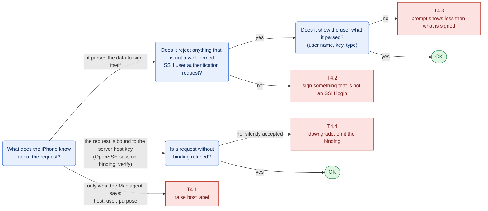

Rules and session approval:

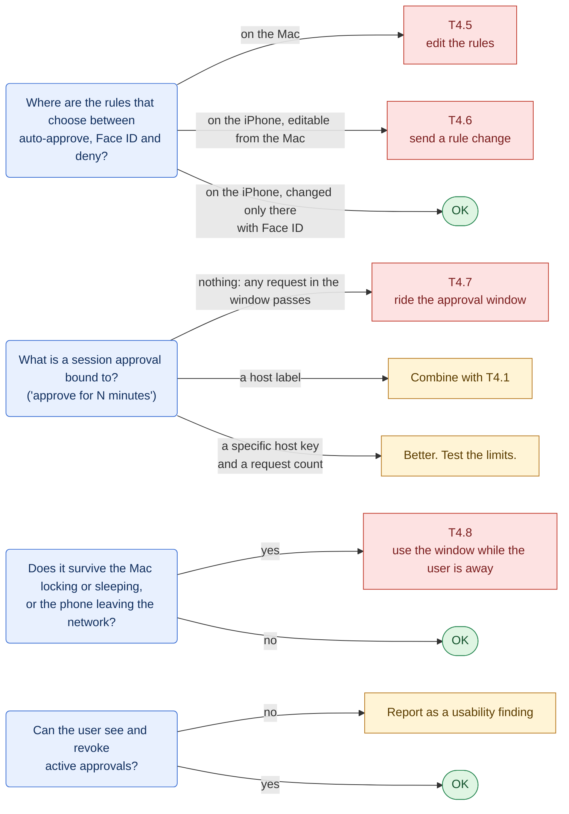

Rate limits, prompt and errors:

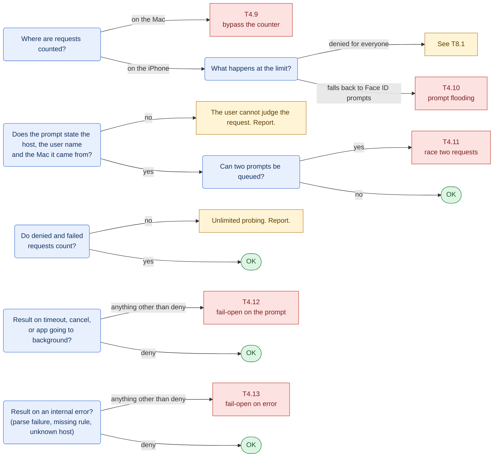

| ID | STRIDE | Attack |
|---|---|---|
| T4.1 | S, E | As AT1, send a request labelled "github.com" whose data to sign is an authentication for another server. The agent protocol does not carry the host name, so the label is an unverified claim. **[verify]** |
| T4.2 | E | Get other data signed with the SSH key: a git commit or file signature (out of scope, must be refused), or arbitrary bytes. |
| T4.3 | S | Find a field that is signed but not displayed, and change it. |
| T4.4 | E | Send the request without the host key binding and check whether it is still signed. |
| T4.5 | E | As AT1, edit the rules stored on the Mac. |
| T4.6 | E | As AT1, send a rule change over the channel. |
| T4.7 | E | As AT1, wait for the user to approve one request, then sign at will until the window closes. |
| T4.8 | E | Use an open approval window after the Mac locked, slept, or the phone left. |
| T4.9 | E | As AT1, reset or skip the counter kept on the Mac. |
| T4.10 | E | Flood the phone with prompts until the user approves one. |
| T4.11 | E | Send a malicious request at the same moment as a legitimate one, so that one approval covers both. |
| T4.12 | E | Let the prompt time out, cancel it, or background the app, and check that the answer is deny. |
| T4.13 | E | Trigger each internal error and check that the answer is deny. The brief requires fail-secure. |

### T5. Key storage on the iPhone

The SSH key in the Secure Enclave:

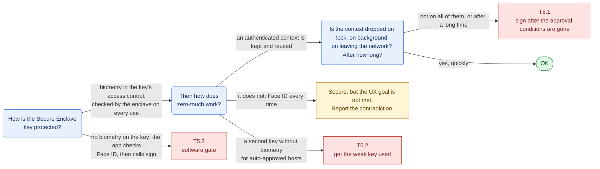

Lock state and biometry changes:

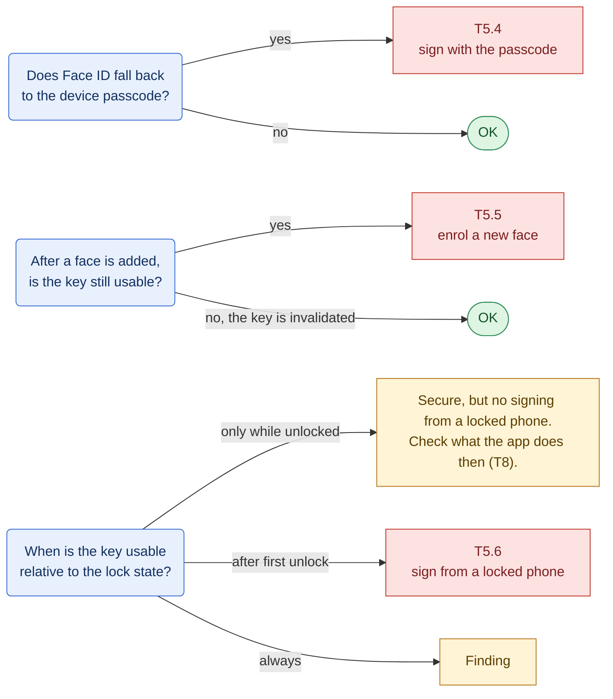

Other stored data:

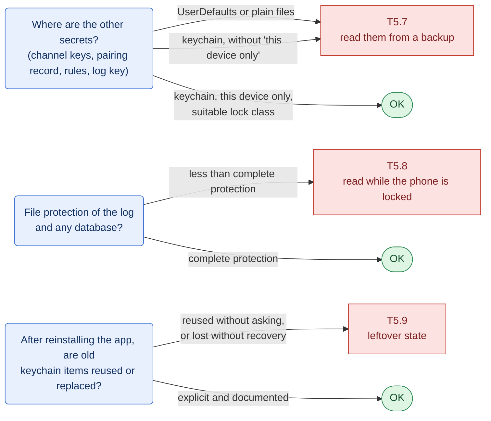

| ID | STRIDE | Attack |
|---|---|---|
| T5.1 | E | Get a signature after the conditions that justified the approval are gone: phone locked, app in background, device off the network. |
| T5.2 | E | Get the key without biometry used for a host that should need the strong one. Combine with T4.1. |
| T5.3 | E | The Face ID check is an `if` in the app, not a property of the key. Same class of flaw as the vault design rejected in journal entry P-002. Look for any path that reaches the sign call without passing the check. |
| T5.4 | E | As AT4 knowing the passcode, sign without the owner's face. |
| T5.5 | E | As AT4 with the passcode, enrol a new face, then sign. Expected with `biometryCurrentSet`: the key is invalidated. |
| T5.6 | E | As AT4, or AT3 if Bluetooth is built, obtain signatures from a locked, stolen or pocketed phone. |
| T5.7 | I | Read the secrets from a device backup or after migration to another device. |
| T5.8 | I | Read the log or database while the phone is locked. |
| T5.9 | S, D | Reinstall the app (it expires every 7 days on a free account). Look for a stale pairing that is still accepted, or a key that is lost with no recovery. |

### T6. Mac agent

Socket and identity key:

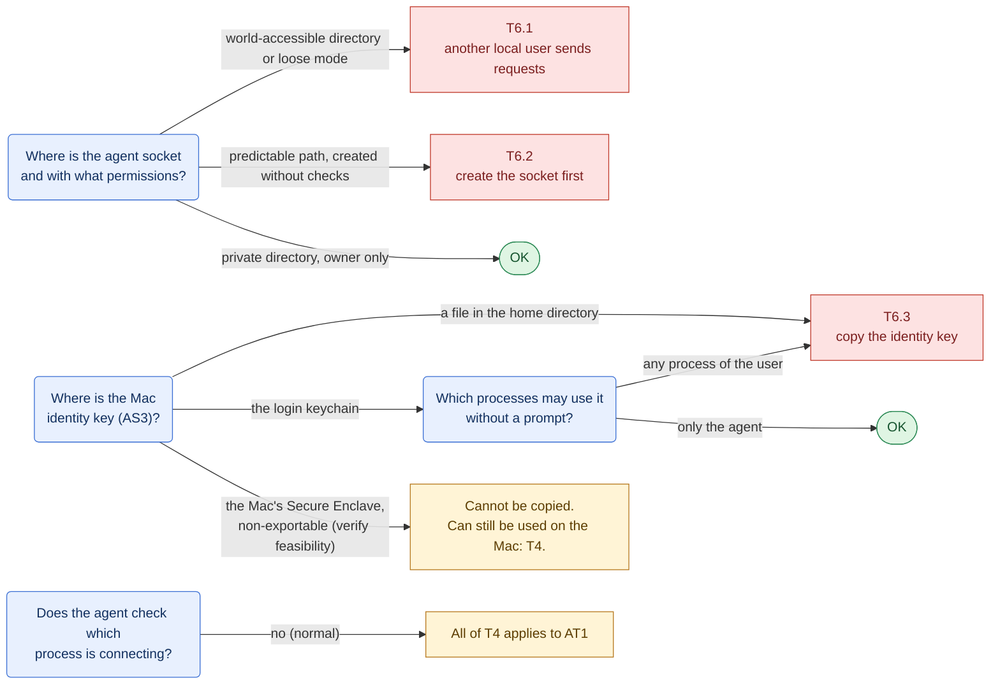

Integrity, forwarding and fallback:

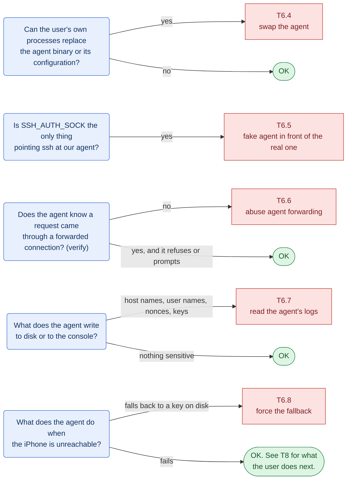

| ID | STRIDE | Attack |
|---|---|---|
| T6.1 | E | Send requests to the socket from another local user account. |
| T6.2 | S | Create the socket path before the agent does and impersonate the agent. |
| T6.3 | S | As AT1, copy the identity key. Then act as the Mac from any device on the network. |
| T6.4 | T | Swap the agent binary or its configuration. Record what the iPhone can and cannot detect. |
| T6.5 | S | As AT1, repoint `SSH_AUTH_SOCK` to a fake agent that relays to the real one and alters or records requests. |
| T6.6 | E | As AT6, with `ssh -A` in use, request signatures for other hosts while the user is connected. |
| T6.7 | I | Read what the agent logged: host names, user names, nonces, keys. |
| T6.8 | E | Make the iPhone unreachable, then steal the fallback key from disk. If a fallback exists, the whole model is void. |

### T7. Decision log

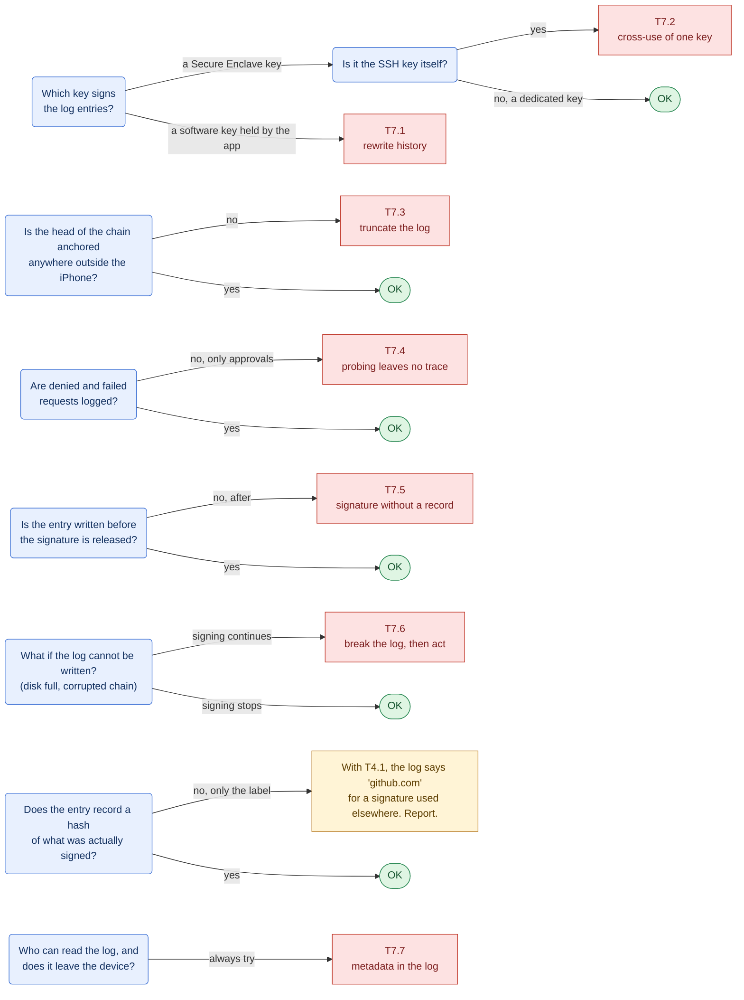

| ID | STRIDE | Attack |
|---|---|---|
| T7.1 | T, R | With control of the app's storage, rewrite entries and re-sign them. |
| T7.2 | E | Craft a log entry that doubles as a valid SSH signature, or the reverse. Keys should have one purpose. |
| T7.3 | R | Delete the last N entries. A hash chain detects edits in the middle, not truncation. |
| T7.4 | R | Send requests that get denied and check that nothing is recorded. |
| T7.5 | R | Interrupt between signature and log write (kill the app, drop the link). |
| T7.6 | R | Fill or corrupt the log, then act unrecorded. |
| T7.7 | I | List what the log reveals. Host names and timestamps are personal and infrastructure data (MASVS PRIVACY). |

### T8. Availability and recovery

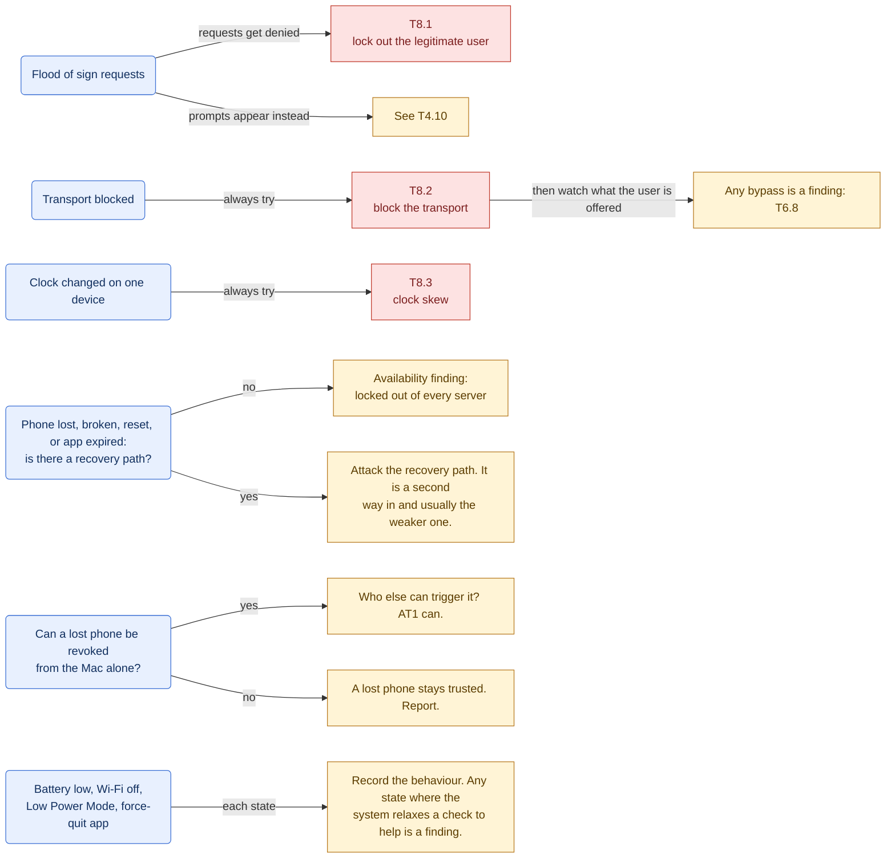

| ID | STRIDE | Attack |
|---|---|---|
| T8.1 | D | Trigger the rate limit so that the legitimate user is locked out. |
| T8.2 | D | Hold connections, flood the listener, or push a device off the Wi-Fi. Check whether the user can still work. |
| T8.3 | D | Change the time on one device. Check whether all requests are rejected and whether the error is understandable. |

### T9. Platform hygiene (MASVS checklist items)

A checklist, not a tree: run every line.

| ID | STRIDE | Area | Check |
|---|---|---|---|
| T9.1 | I | Console and system logs | Run a full session with Console.app open. Search for keys, nonces, hosts. |
| T9.2 | I | App switcher snapshot | Background the app on a sensitive screen. Is the preview masked? |
| T9.3 | I | Pasteboard | Is anything copied (fingerprints, public keys)? Local only, with expiry? |
| T9.4 | I | Screenshots and recording | Is the pairing QR or an approval screen capturable while a secret is shown? |
| T9.5 | | Permissions | Does the app request more than local network, camera (QR) and Face ID? When? |
| T9.6 | E | URL schemes | Can another app open SentryKey straight into an approval or a pairing? |
| T9.7 | E | Debug leftovers | Test hosts, bypass flags, verbose modes in the release build. |
| T9.8 | T | Dependencies | Anything beyond Apple frameworks? Does each package exist and is it the real one? |
| T9.9 | I | Secrets in the repository | Search the history, not only the current tree. |
| T9.10 | | Jailbroken or debugged device | Does the app notice? Low priority, but MASVS RESILIENCE asks the question. |

## 4. State matrix

Run the same `ssh` command in each combination and record what happened. The "secure outcome" column is our proposal. The team has not decided these yet, and an undecided cell is itself a J1 finding.

| # | iPhone state | Mac state | Secure outcome |
|---|---|---|---|
| S1 | Unlocked, app in foreground | Unlocked | Per policy |
| S2 | Unlocked, app in background | Unlocked | Per policy |
| S3 | Locked, app in background | Unlocked | Deny or notify. Never sign silently unless the team has accepted T5.6. |
| S4 | Locked, never unlocked since reboot | Unlocked | Deny |
| S5 | App force-quit | Unlocked | Fail, with a clear message |
| S6 | Unreachable: other network or Wi-Fi off | Unlocked | Fail. No fallback key. |
| S7 | Reachable | Locked or screensaver | Deny auto-approval |
| S8 | Reachable | Asleep, then woken by a scheduled job | Deny auto-approval |
| S9 | Reachable, session approval active | User switched to another account | Deny |
| S10 | Two paired Macs reachable | Both sending | Each request attributed to the right Mac |
| S11 | Any | Agent restarted mid-session | New handshake, old session rejected |
| S12 | App restarted mid-session | Any | New handshake, counters not reset under an old key |
| S13 | Clock off by 10 minutes | Any | Reject, with a clear message |
| S14 | Face enrolment changed | Any | Key invalidated, re-pairing required |
| S15 | App reinstalled after expiry | Any | Explicit re-pairing or documented key survival |

S2 to S4 over the local network: the app may simply be unreachable (section 2.5). If so, record that, and record what the user is told.

## 5. From tree to finding

The brief's loop is specify, generate, review, test, attack. A finding at the attack step sends the function back to the specification step.

Before J3 (no code): walk each tree as a design review. Every question the team cannot answer, and every branch that ends in an attack under the current design, goes into the STRIDE model for J1.

From J3: turn each red box into a test and write up the ones that succeed.

```markdown
### F-XXX · Short title

- **Tree reference:** T4.1
- **STRIDE:** S, E
- **MASVS domain:** AUTH
- **Attacker:** AT1
- **Preconditions:**
- **Steps to reproduce:**
- **Observed result:**
- **Expected result:**
- **Impact:** which asset (AS1 to AS6), and what the attacker gains
- **Suggested fix:**
- **Status:** Open / Fixed in PR # / Accepted risk, and who accepted it
```

Suggested order once code exists: T4, T5, T1, T2, T6, T3, T7, T8, T9. The first three decide whether the project's main claim holds.

## Appendix A. Bluetooth Low Energy (optional transport)

Bluetooth is an optional second transport. Read this only if the team builds it. Its attacks are T3.B1 to T3.B6, in the Bluetooth diagram of T3.

### A.1 Radio and link

- BLE uses the 2.4 GHz band, split into 40 channels. Three are advertising channels (37, 38, 39). The other 37 carry data.
- A device that wants to be found **advertises**: it broadcasts small packets on the advertising channels. A device that wants to find others **scans**.
- Once connected, the two devices hop between data channels on a schedule agreed at connection time. A sniffer has to catch the connection request to follow the hopping.
- Advertising packets are always in clear text. Anyone nearby sees them.

### A.2 Roles

Two independent pairs of roles:

| Layer | Roles | Meaning |
|---|---|---|
| GAP (connection) | Peripheral / Central | The peripheral advertises. The central scans and initiates the connection. |
| GATT (data) | Server / Client | The server holds data. The client reads and writes it. |

In practice the peripheral is usually the GATT server. In CoreBluetooth these are `CBPeripheralManager` (peripheral) and `CBCentralManager` (central).

**Design question for the team:** which side is the peripheral? It changes the background behaviour on iOS (A.5) and who can impersonate whom (T3.B1).

### A.3 GATT: how data is exchanged

- A server exposes **services**. A service contains **characteristics**. Each has a UUID.
- A characteristic is a small value with permitted operations:
  - **read**: client fetches the value.
  - **write**: client sends a value and gets an acknowledgement.
  - **write without response**: same, without acknowledgement.
  - **notify** / **indicate**: server pushes a new value to subscribed clients. Indicate is acknowledged.
- Each operation carries a limited number of bytes: the negotiated MTU minus 3 bytes of header. The default MTU is 23, so 20 bytes of payload. Larger values are negotiated per connection. In CoreBluetooth, ask `maximumWriteValueLength(for:)` rather than assuming a number.
- A signature request does not fit in one packet. The app must **fragment and reassemble** messages. That reassembly code is hand-written parsing of attacker-controlled input, which makes it a prime target (T3.9).

### A.4 Security built into BLE, and why we do not rely on it

BLE has its own encryption, set up by **pairing**:

| Pairing method | Protection against a man in the middle |
|---|---|
| Just Works | None |
| Passkey entry | Yes |
| Numeric comparison | Yes |
| Out of band | Depends on the other channel |

- Pairing produces a long-term key. Storing it for later is called **bonding**.
- "LE Secure Connections" (Bluetooth 4.2 and later) uses ECDH P-256. The older "legacy pairing" is weak against a passive sniffer.
- On iOS the app does not choose the pairing method and cannot inspect the result. The system decides. **[verify]**
- Consequence: SentryKey treats the BLE link as an untrusted pipe, exactly like the brief treats the Wi-Fi network. All confidentiality and authentication come from the application channel (ECDH + HKDF + AES-GCM). If any security property depends on BLE link encryption being on, that is a finding.

### A.5 iOS specifics that shape the attack surface

- **No stable address.** iPhones use random addresses that rotate. CoreBluetooth never exposes the hardware address. It gives a per-device UUID that is only meaningful on that device. Identity therefore has to be cryptographic. Any check based on device name or identifier is spoofable.
- **Background execution.** The app needs the `bluetooth-peripheral` or `bluetooth-central` background mode to work with the screen off.
  - In the background, a peripheral's advertising is degraded: the local name is dropped and service UUIDs go to an "overflow area" that Apple documents as discoverable only by a device explicitly scanning for that UUID. Whether a Mac finds a backgrounded iPhone reliably is the riskiest assumption of the project. **[verify]**
  - In the background, a central must scan for specific service UUIDs and scans less often.
  - If the user force-quits the app, the system stops relaunching it for Bluetooth events. **[verify]**
- **Locked phone.** Bluetooth still works. Keychain items and Secure Enclave keys may not, depending on their protection class (tree T5).
- **Permissions.** Both apps need the Bluetooth usage description, and the Mac agent needs the user's Bluetooth consent. How this works for a command-line agent is unconfirmed. **[verify]**

### A.6 RSSI and proximity

- RSSI is the received signal strength, in dBm. Closer to zero means stronger.
- It is not a distance. It varies with body position, walls, pockets and antenna orientation, by tens of dB.
- An attacker can raise it with an amplifier or a directional antenna, and lower it with shielding.
- A **relay** defeats any proximity check based on "we can talk, so we are close". The relay forwards radio traffic unchanged, so encryption and signatures still verify. Cryptography proves *who*, not *where*.
- Real distance bounding needs time-of-flight hardware such as ultra-wideband. Whether that is usable between an iPhone 14 Pro and our Mac has not been checked. **[verify]**

### A.7 Tools

| Tool | Use |
|---|---|
| nRF Connect (iOS / Android) | Browse advertisements, connect, read and write characteristics by hand. First tool to reach for. |
| PacketLogger (Xcode additional tools) | Capture the Mac's own Bluetooth traffic at the host level. |
| LightBlue | Simulate a peripheral from a phone or Mac: quick fake SentryKey device. |
| nRF52840 dongle + Wireshark | Sniff traffic between two other devices. Needed for passive capture and replay tests. |
| A second Mac or phone running our own code | The simplest fake agent or fake iPhone. Often enough, and no extra hardware. |
