# SentryKey red team guide

Working notes for whoever holds the red team role at the current milestone. The role rotates, so this file is written to be picked up cold.

It contains:

1. A model of the system and of the attackers we consider, and what the design already answers.
2. A primer on Bluetooth Low Energy, limited to what matters for attacking SentryKey.
3. Decision trees: for each part of the system, the questions to ask about the implementation and the attack to try for each answer.
4. A state matrix, a per-milestone plan, a finding template, and a list of questions the design leaves open.

Scope: our own app, our own devices, and at J4 the other group's app with their agreement. Nothing here is to be run against devices or networks that are not ours.

**Status:** there is no code yet. This guide is aligned with `docs/ARCHITECTURE.md` as proposed in pull request #1 (commit `7ac715f`). If that document changes, this guide has to follow. `docs/THREAT_MODEL.md` was written from the earlier README design and still describes per-host policy, session approval, proximity and fingerprint comparison at pairing. The team works from the architecture document, so those are not tested here (see section 7, item 11). Items marked **[verify]** are claims about Apple or OpenSSH behaviour that nobody on the team has confirmed on a real device or in the documentation. Confirm them before writing them into a report.

## 1. System model

```
            Mac (untrusted host)                          iPhone (trusted device)
 ┌───────────────────────────────────────┐        ┌────────────────────────────────────┐
 │ ssh / git                             │        │ SentryKey app                      │
 │    │  ssh-agent protocol              │        │   BLE peripheral ── channel        │
 │    ▼  (unix socket, IdentityAgent)    │  BLE   │        │                           │
 │ Mac agent ── channel ── BLE central ══╪════════╪════════╯                           │
 │    │                                  │        │   host verifier (session-bind)     │
 │ Mac identity key (Secure Enclave)     │        │   approval: notification, Face ID  │
 │ phone public keys, log head mirror    │        │   SSH key (Secure Enclave)         │
 └───────────────────────────────────────┘        │   hash-chained log                 │
                                                  └────────────────────────────────────┘
        boundary 1: socket        boundary 2: radio         boundary 3: app ↔ enclave
```

The flow for one SSH login, from the architecture document:

1. `ssh` sends the agent a `session-bind@openssh.com` message (server host key, session identifier, server signature), then a sign request.
2. The Mac agent forwards both to the phone over the encrypted channel.
3. The phone verifies the server's signature itself and checks that the data to sign is a login for that same session.
4. The phone posts a local notification showing the host-key fingerprint, the name recorded for it, and the user name.
5. The user taps it, the app comes to the foreground, Face ID unlocks the key, the Secure Enclave signs.
6. The signature goes back to `ssh`. The Mac gives up after 30 to 60 seconds.

### Trust boundaries

The five boundaries named in `docs/THREAT_MODEL.md`, and where this guide tests each:

| Boundary | What crosses it | Trees |
|---|---|---|
| Mac process | `ssh` and any other local process ↔ the agent's socket | T6, T4 |
| Device | Mac agent ↔ iPhone app over Bluetooth | T2, T3 |
| Pairing | QR code, camera, and what the user confirms | T1 |
| iPhone security | Untrusted request data ↔ approval and Secure Enclave | T4, T5, T7 |
| External | Signatures leave for `ssh` and the server. A compromised Mac can use any signature it obtains | T4.10, T6.7 |

### Assets

| ID | Asset | Where it lives | What losing it means |
|---|---|---|---|
| AS1 | SSH signing key | iPhone Secure Enclave, Face ID on every use | Not extractable by design. The realistic loss is *use*, not theft. |
| AS2 | Ability to obtain a signature | The whole chain | An attacker logs in to our servers or pushes to our repositories. This is the asset that matters. |
| AS3 | Backup SSH key | Offline, by design | A second key valid on every server, with no Face ID and no log. |
| AS4 | Mac identity key and stored phone public keys | Mac Secure Enclave, Mac storage | Whoever can use it is "the Mac" to the iPhone. |
| AS5 | Phone identity key | iPhone Secure Enclave, usable after first unlock, no Face ID | Whoever can use it is "the phone" to the Mac. |
| AS6 | Session keys | Memory on both sides | Read and forge channel traffic for one connection. |
| AS7 | Decision log and its mirrored head | iPhone, head on the Mac | Lose the ability to prove what was approved. |
| AS8 | Metadata: host fingerprints and names, user names, times, list of servers per key | Phone, Mac menu bar, notifications | Privacy leak, and a map of our infrastructure. |

### Attackers

| ID | Attacker | Capability |
|---|---|---|
| AT1 | Malware on the Mac | Runs as the logged-in user. Reads the user's files, connects to the user's sockets, edits `~/.ssh/config`, starts processes. This is the attacker the project exists to stop. The design assumes it is **not** present at pairing time. |
| AT2 | Radio attacker nearby | Within Bluetooth range. Listens, connects to the phone's service, writes to it, advertises fake devices, jams. |
| AT3 | Relay pair | Two radios, one near the iPhone and one near the Mac, forwarding traffic between them. |
| AT4 | Phone thief | Holds the iPhone, locked or unlocked, possibly knowing the passcode. |
| AT5 | Mac thief | Holds the Mac, locked or unlocked, without the iPhone. |
| AT6 | Malicious server | A host we connect to, with or without agent forwarding. |
| AT7 | The legitimate user | Denies having approved something. |

### What the design already answers

The red team's job on these points is to check that the implementation really does what the document says.

| Threat | Answer in `docs/ARCHITECTURE.md` | Verified by |
|---|---|---|
| Malware uses the agent as a signing oracle | Face ID for every signature, enforced by the Secure Enclave | T4.10, T4.11, T5.1, T5.2 |
| The Mac lies about which server is asking | The phone verifies `session-bind` itself and shows the host-key fingerprint | T4.2 to T4.6 |
| Prompt flooding until the user approves | Rate limit, then a cooldown during which requests are denied | T4.15, T8.1 |
| Man in the middle at pairing | One-time secret in the QR code authenticates the phone's keys | T1.1 to T1.5 |
| Recorded traffic decrypted later | Ephemeral ECDH per connection, signed by both identity keys | T2.1, T2.8 |
| Nonce reuse, reflection | One key per direction, counter nonces, close on wrap | T2.5, T2.6 |
| Log truncated or deleted | Chain head and counter mirrored on the Mac, compared on reconnect | T7.2, T7.3 |
| Key stolen from the Mac | SSH key on the phone, Mac identity key in the Mac's Secure Enclave | T6.6, T8.4 |
| Phone lost or Face ID re-enrolled | Offline backup key, list of servers per key | T8.4 to T8.6 |

Known and accepted by the team:

- **At J3**, the host shown on the phone is the one reported by the Mac, labelled "unverified". Session-bind verification arrives at J4.
- **Residual risk:** approval is bound to the server, not to the local process. Malware can open its own connection to a server the user is about to approve and receive the signature.
- **Assumption:** the Mac is not compromised at pairing time.

### Which tree to open

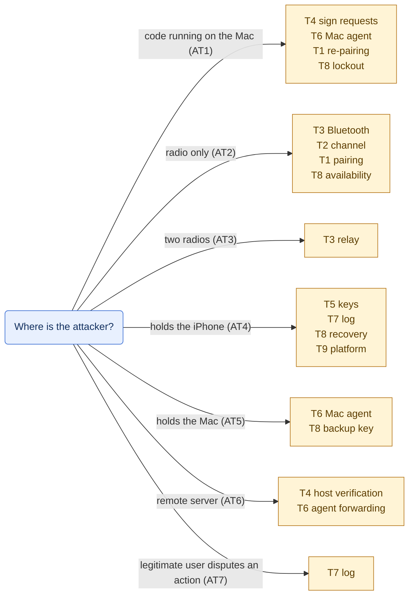

## 2. Bluetooth Low Energy primer

### 2.1 Radio and link

- BLE uses the 2.4 GHz band, split into 40 channels. Three are advertising channels (37, 38, 39). The other 37 carry data.
- A device that wants to be found **advertises**: it broadcasts small packets on the advertising channels. A device that wants to find others **scans**.
- Once connected, the two devices hop between data channels on a schedule agreed at connection time. A sniffer has to catch the connection request to follow the hopping.
- Advertising packets are always in clear text. Anyone nearby sees them.

### 2.2 Roles

Two independent pairs of roles:

| Layer | Roles | Meaning |
|---|---|---|
| GAP (connection) | Peripheral / Central | The peripheral advertises. The central scans and initiates the connection. |
| GATT (data) | Server / Client | The server holds data. The client reads and writes it. |

In SentryKey the **iPhone is the peripheral** (`CBPeripheralManager`, `bluetooth-peripheral` background mode) and the **Mac is the central** (`CBCentralManager`).

### 2.3 GATT: how data is exchanged

- A server exposes **services**. A service contains **characteristics**. Each has a UUID.
- A characteristic is a small value with permitted operations:
  - **read**: client fetches the value.
  - **write**: client sends a value and gets an acknowledgement.
  - **write without response**: same, without acknowledgement.
  - **notify** / **indicate**: server pushes a new value to subscribed clients. Indicate is acknowledged.
- Each operation carries a limited number of bytes: the negotiated MTU minus 3 bytes of header. The default MTU is 23, so 20 bytes of payload. Larger values are negotiated per connection. In CoreBluetooth, ask `maximumWriteValueLength(for:)` rather than assuming a number.
- A signature request does not fit in one packet. The `Framing` module splits and reassembles messages. That code parses attacker-controlled input, and it runs **before** the channel handshake has authenticated anyone (T3.3, T3.6).

### 2.4 Security built into BLE, and why we do not rely on it

BLE has its own encryption, set up by **pairing**:

| Pairing method | Protection against a man in the middle |
|---|---|
| Just Works | None |
| Passkey entry | Yes |
| Numeric comparison | Yes |
| Out of band | Depends on the other channel |

- Pairing produces a long-term key. Storing it for later is called **bonding**.
- "LE Secure Connections" (Bluetooth 4.2 and later) uses ECDH P-256. The older "legacy pairing" is weak against a passive sniffer.
- On iOS the app does not choose the pairing method and cannot inspect the result. The system decides. **[verify]**
- Consequence: SentryKey treats the BLE link as an untrusted pipe. All confidentiality and authentication come from the application channel (signed ephemeral ECDH, HKDF, AES-GCM). If any security property depends on BLE link encryption or bonding being on, that is a finding.

### 2.5 How SentryKey uses it, and what that exposes

- **Any device in range can connect to the phone and write to its characteristic.** BLE has no access control at this level unless the characteristic requires an encrypted link, which the design does not rely on. Everything the app does on an unauthenticated write is reachable by a stranger: waking up, parsing, answering.
- **Wake-up on write.** The Mac writes to the characteristic, iOS wakes the suspended app for about 10 seconds, the app posts a local notification. Face ID cannot run in that window: it needs the app in the foreground.
- **Background advertising is degraded.** The local name is dropped and service UUIDs go to an "overflow area" that only iOS devices scanning for that UUID can read. The Mac therefore scans only during pairing, with the app in the foreground. Afterwards it reconnects to a stored identifier with `retrievePeripherals(withIdentifiers:)` and `connect()`. **[verify]**
- **No stable address.** iPhones use random addresses that rotate. CoreBluetooth gives a per-device UUID that is only meaningful on that device. Whether the Mac's stored identifier survives address rotation is an open question in the architecture. Identity has to be cryptographic: any check based on name or identifier is spoofable.
- **When iOS does not relaunch the app:** after a force-quit, after Bluetooth is toggled off in Control Center, after Airplane Mode, and after a reboot until the first unlock. The Mac shows "Phone unreachable: open SentryKey". **[verify]** on the iOS version used for tests.
- **Locked phone.** Bluetooth still works and the phone identity key is usable (`AfterFirstUnlock`), so the handshake succeeds. The SSH key is not usable (`WhenUnlocked` and Face ID).

### 2.6 Signal strength and relay

- RSSI is the received signal strength, in dBm. It is not a distance: it varies by tens of dB with body position, walls and antenna orientation, and an attacker can raise or lower it.
- A **relay** forwards radio traffic unchanged between two places, so encryption and signatures still verify. Cryptography proves *who*, not *where*.
- With Face ID on every signature, a relay alone gets nothing: the user still has to approve. It matters for the stretch goal (Mac proximity lock), and for what the user is told when a prompt arrives while they are away from the Mac.
- The iPhone 14 Pro has an ultra-wideband chip that could measure real distance, but Macs have none.

### 2.7 Tools

| Tool | Use |
|---|---|
| nRF Connect (iOS / Android) | Browse advertisements, connect, read and write characteristics by hand. First tool to reach for. |
| LightBlue | Same, and can simulate a peripheral: quick fake SentryKey phone. |
| PacketLogger (Xcode additional tools) | Capture the Mac's own Bluetooth traffic at the host level. |
| nRF52840 dongle + Wireshark | Sniff traffic between two other devices. Needed for passive capture and replay tests. |
| A second Mac or phone running our own code | The simplest fake agent or fake iPhone. Often enough, and no extra hardware. |
| `ssh -v`, `ssh-add -L`, `ssh-keygen -Y verify` | Observe and check the SSH side. |

Adding any of these to the repository as a dependency follows the vetting rule in `CONTRIBUTING.md`.

## 3. Decision trees

How to read them:

- Each tree is one or more diagrams followed by a table.
- **Blue** boxes are questions about the implementation. Answer them by reading the code or by testing. The answer is on the arrow.
- **Red** boxes are attacks to try. The ID (for example `T4.7`) is what a finding report cites. The table under the diagram says exactly what to do.
- **Green** boxes are the secure answer. Still confirm it with a test.
- **Yellow** boxes are things to report or a pointer to another tree.
- STRIDE letters in the tables: **S**poofing, **T**ampering, **R**epudiation, **I**nformation disclosure, **D**enial of service, **E**levation of privilege.

### T1. Pairing

Design: the Mac shows a QR code with its identity public key and a one-time pairing secret. The phone sends its public keys back over BLE, authenticated with that secret. The secret is then discarded.

The pairing secret:

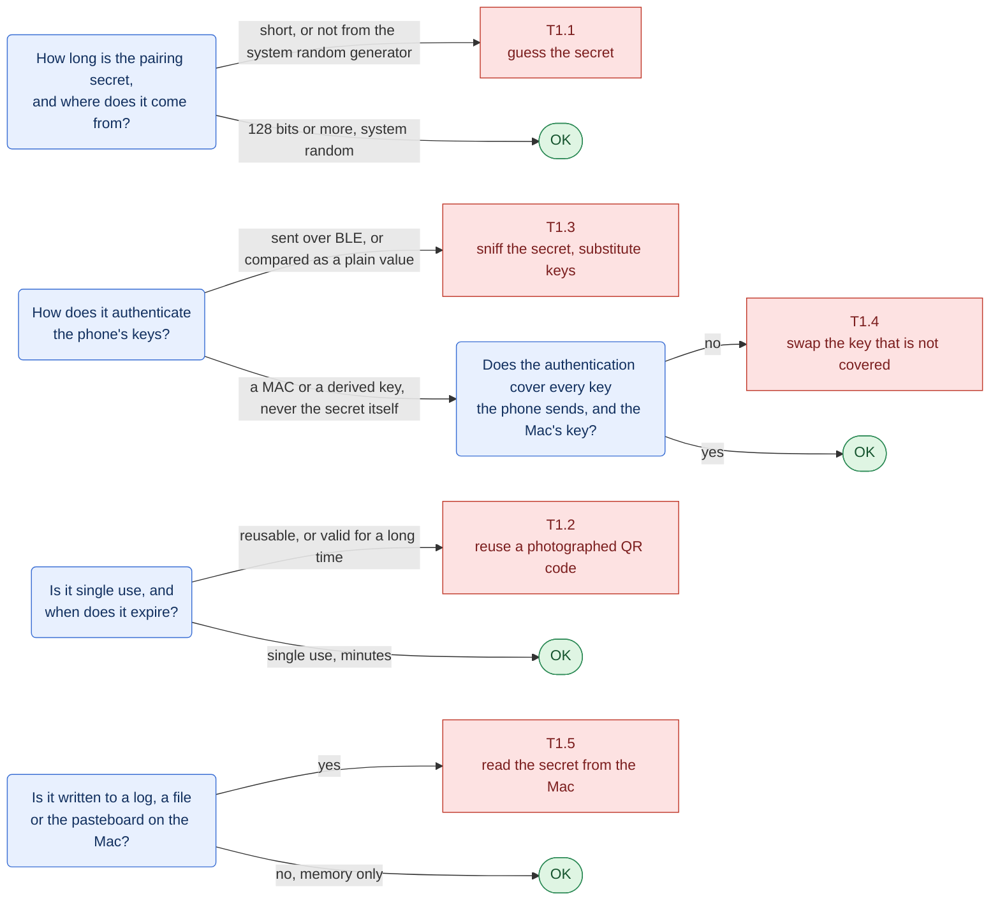

Pairing lifecycle:

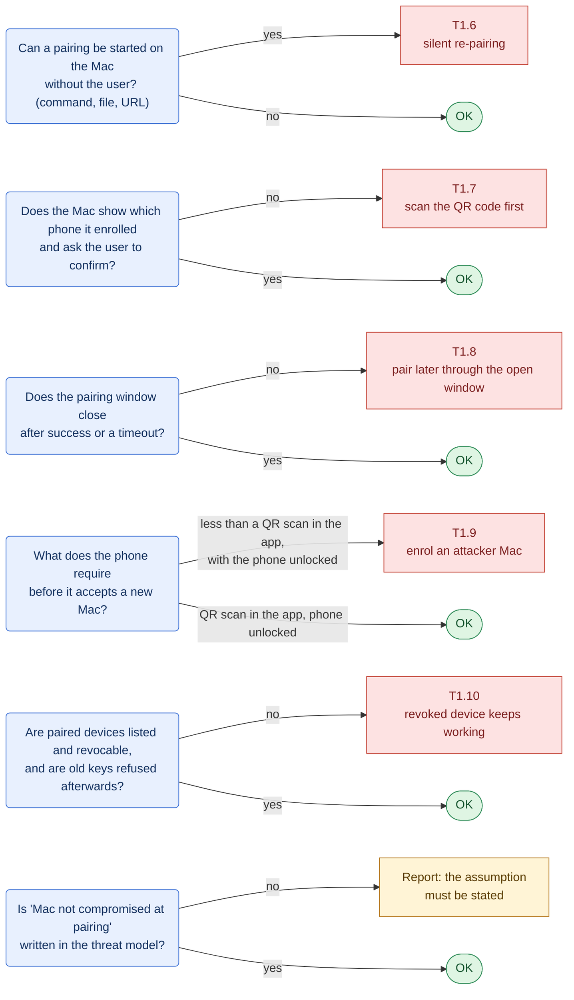

| ID | STRIDE | Attack |
|---|---|---|
| T1.1 | S | Guess or brute-force the pairing secret within its lifetime. |
| T1.2 | S | Photograph the QR code, then use it after the legitimate pairing or for a second one. |
| T1.3 | S | Capture the pairing exchange over BLE, recover the secret, and replace the phone's keys with ours. |
| T1.4 | S | Leave the authenticated key in place and swap another one. Typical case: the identity key is covered but the SSH public key is not, so the Mac displays our SSH key for the user to install on servers. |
| T1.5 | I | As AT1, read the secret from where the Mac wrote it. Outside the stated assumption, but a log file outlives the pairing. |
| T1.6 | E | As AT1, start a pairing silently and enrol our phone. The Mac then shows our SSH public key as the one to install on servers. |
| T1.7 | S | Photograph the QR code from a distance and complete the pairing before the user's phone does. |
| T1.8 | S | Connect during a pairing window that was left open. |
| T1.9 | S | Get the phone to accept a Mac it should not: QR shown on a web page, link, request over BLE. |
| T1.10 | E | Revoke a Mac or a phone, then keep using its old identity key. |

### T2. Application channel

Design: on each connection, both sides exchange ephemeral ECDH keys signed by their identity keys. HKDF derives one AES-GCM key per direction. Nonces are a per-direction counter. A timestamp is checked as a coarse window only.

Handshake:

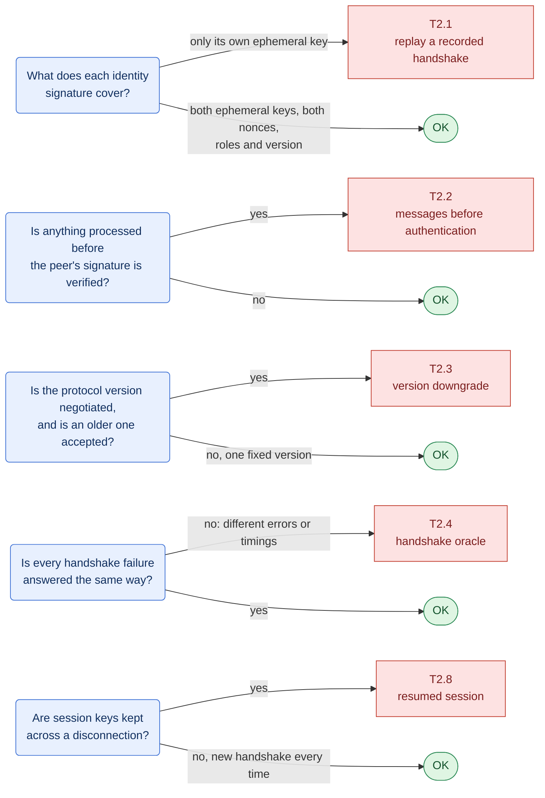

Messages:

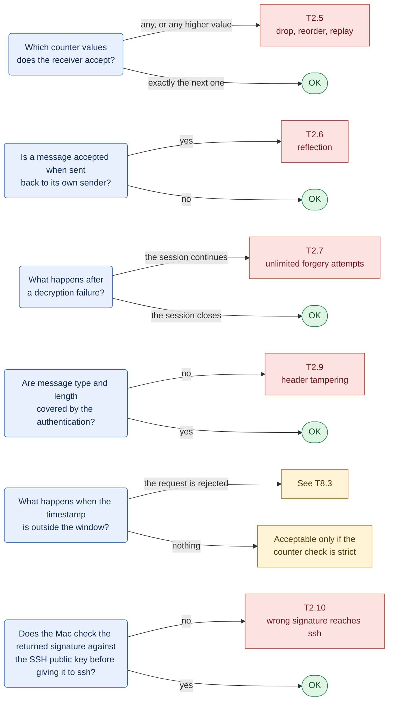

| ID | STRIDE | Attack |
|---|---|---|
| T2.1 | S | Record a handshake, then replay one side's signed message in a new connection. Expected: failure. |
| T2.2 | T | Send channel messages before or instead of the handshake and see whether any is acted on. |
| T2.3 | T | Offer an older or unknown protocol version and see whether the peer follows. |
| T2.4 | I | Compare responses to a bad signature, an unknown key and a malformed message. The difference tells a stranger whether this phone is paired with a given Mac. |
| T2.5 | T | Inside one session, drop a message, swap two, and send one twice. |
| T2.6 | T | Send a captured message back to the side that produced it. |
| T2.7 | T | Send forged messages repeatedly on one session. The session should close at the first failure. |
| T2.8 | I, T | Disconnect and reconnect. Check that keys and counters are new, so that no nonce repeats under an old key. |
| T2.9 | T | Change the type or length field of a captured message and check whether it is still accepted. |
| T2.10 | T | Make the phone side return a signature that is malformed, made with another key, or made over other data. Expected: the Mac rejects it before `ssh` sees it. Also check a normal signature end to end with a real login and `ssh-keygen -Y verify`. |

### T3. Bluetooth transport

Reachable by anyone in radio range, before any authentication:

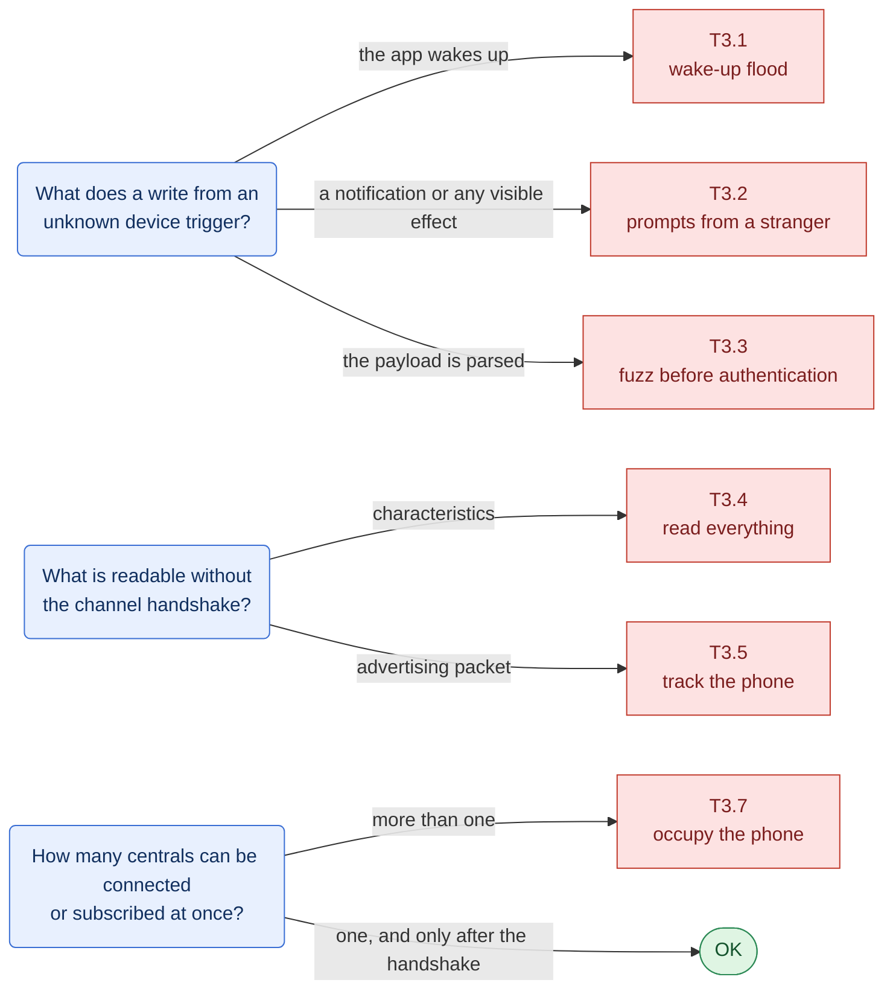

Framing and parsing:

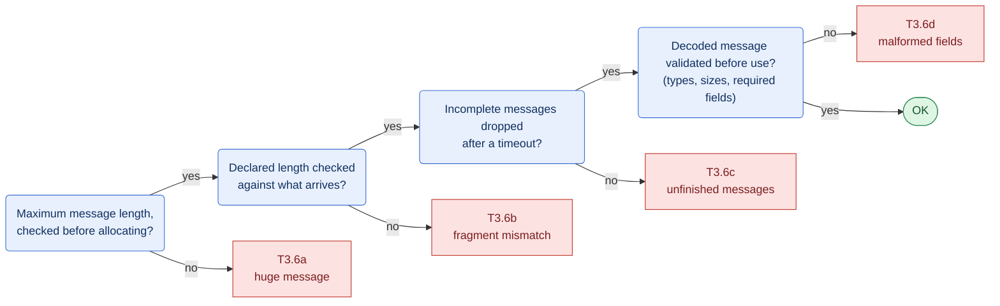

Identity, relay and the stretch goal:

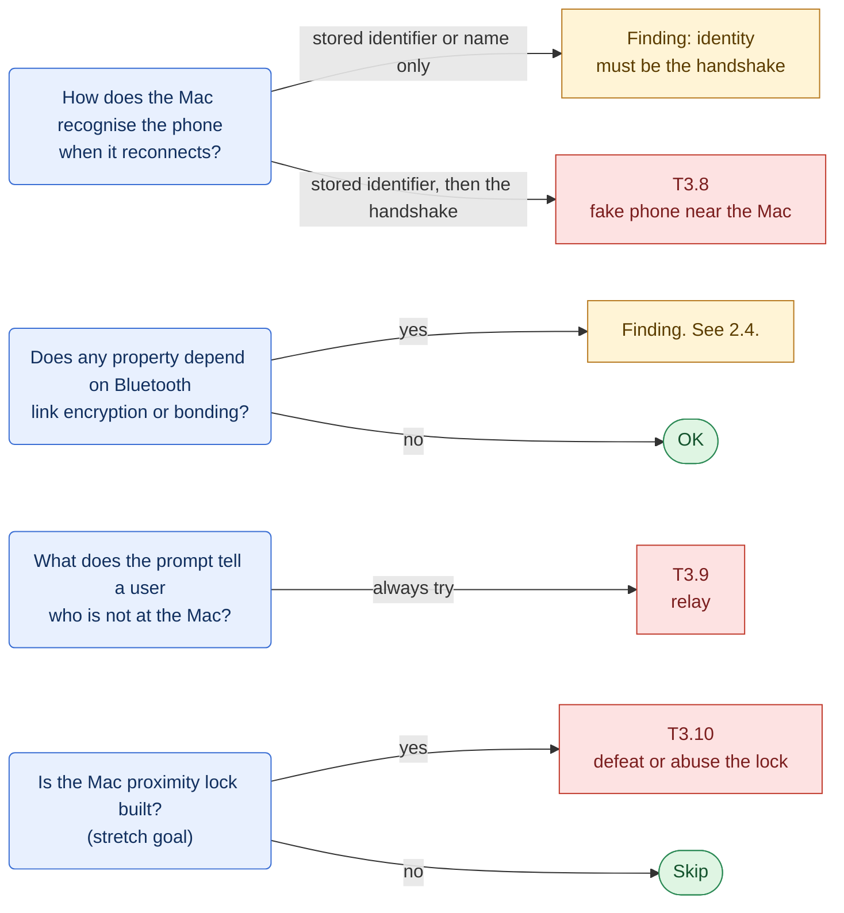

| ID | STRIDE | Attack |
|---|---|---|
| T3.1 | D | From an unpaired device, write to the characteristic in a loop. Measure battery drain and whether real requests are delayed. |
| T3.2 | S | From an unpaired device, try to make the phone show anything: a notification, a badge, a sound. Expected: nothing visible before the handshake. |
| T3.3 | T | Send malformed frames from an unpaired device. This is the parsing code a stranger can reach. Expected: dropped, no crash. |
| T3.4 | I | Read every characteristic and descriptor with nRF Connect without pairing. Note what leaks. |
| T3.5 | I | Look at the advertisement. A fixed service UUID tells anyone nearby that this person uses SentryKey and lets them follow the phone. |
| T3.6a | D | Announce a huge message and exhaust memory. |
| T3.6b | T | Send overlapping, short, extra and out-of-order fragments. |
| T3.6c | D | Start many messages and never finish them. |
| T3.6d | T | Send malformed fields, wrong types, empty or oversized strings. |
| T3.7 | D, I | Connect and subscribe from a second device. Check whether the real Mac is starved, and whether our device receives the encrypted responses (sizes and timing). |
| T3.8 | S | Advertise as the phone near the Mac while the real phone is away. Expected: connection, then failure at the handshake. Anything more is a finding. |
| T3.9 | S | Relay the paired Mac to the phone at a distance (AT3). Cheap version first: how far away, through walls, does a request still reach the phone? Record what the prompt says. |
| T3.10 | S, D | If the proximity lock exists: keep the Mac unlocked with a relay or a fake phone, or lock it repeatedly by jamming. |

### T4. Sign requests and approval

This is where the central claim of the project is tested: malware on the Mac must not be able to get a signature the user did not intend.

Starting point: any process of the user can connect to the agent's unix socket, or bypass the agent (T6.4). Assume AT1 can send any request it likes to the phone.

What the phone verifies:

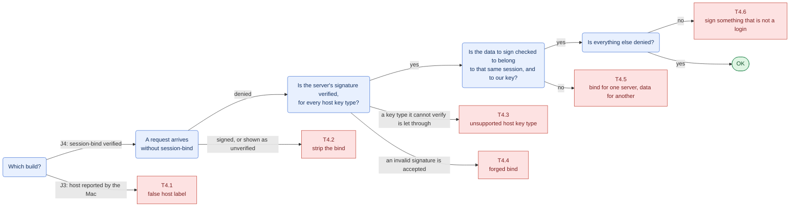

What the user is shown:

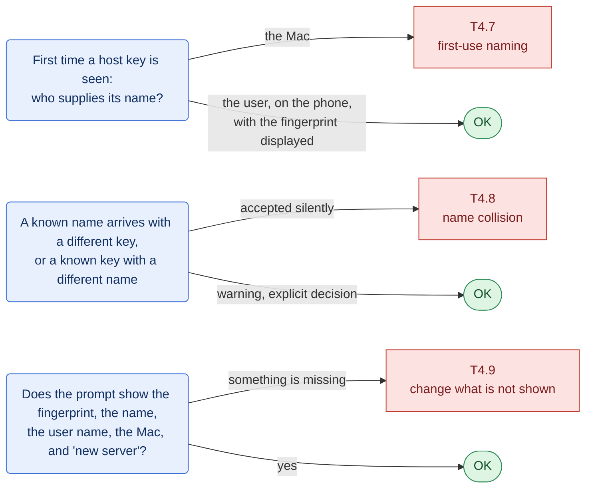

How approval works:

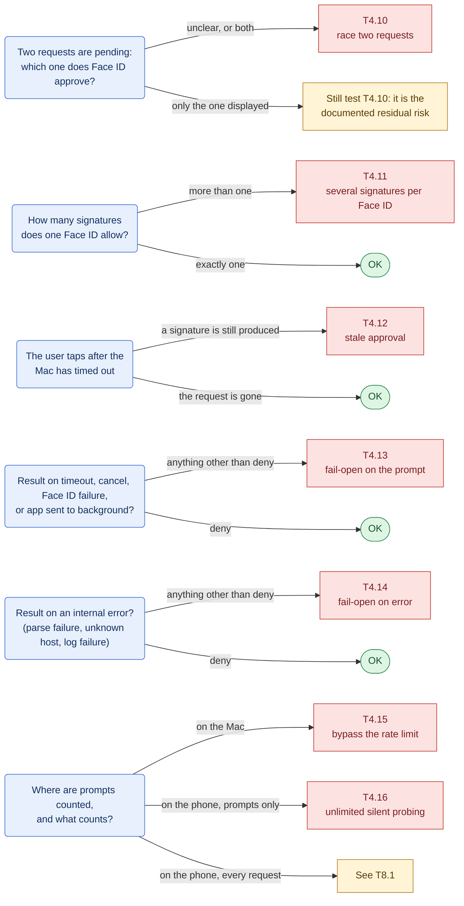

| ID | STRIDE | Attack |
|---|---|---|
| T4.1 | S, E | At J3 only. As AT1, send a request labelled "github.com" whose data to sign is a login to another server. Expected to succeed: the design accepts it until J4. Check that the phone says "unverified", and report it as an accepted risk with its end date. |
| T4.2 | E | As AT1, forward the sign request without the `session-bind` message, or use an `ssh` older than 8.9. Expected: denied, never "signed as unverified". |
| T4.3 | E | Use a server whose host key type the phone cannot verify. Expected: denied. Skipping the check is the fail-open to look for. |
| T4.4 | S | Send a bind whose server signature is invalid, truncated, or made with another key. |
| T4.5 | E | Send a valid bind for server A, then data to sign whose session identifier belongs to server B. Also try a public key that is not ours. **[verify]** With session-bind, OpenSSH uses the `publickey-hostbound-v00@openssh.com` method, which puts the host key inside the signed data: check that the phone compares it too. |
| T4.6 | E | Ask for a signature over something that is not an SSH login: an SSHSIG blob (git commit signing is a stretch goal, so it must be denied until built, and only the `git` namespace afterwards), arbitrary bytes, a login with trailing data. |
| T4.7 | S | As AT1, connect to a server the phone has never seen and supply the name. Example: a production server announced as "github.com". The bind is valid, so only the name is false. |
| T4.8 | S | Give a new host key a name that already exists, or rename a known key, and check whether the user is told. |
| T4.9 | S | Find a field that is signed but not displayed, and change it. Typical case: log in as `root` when the user expects their own account. |
| T4.10 | E | As AT1, open our own connection to a server at the moment the user starts theirs. Record how many prompts appear, what distinguishes them, and whether one approval can serve our request. |
| T4.11 | E | Send two requests back to back and approve once. Expected: one signature. A reused authentication context is the usual cause of failure. |
| T4.12 | E | Let the Mac time out, then tap the notification. Check that no signature is produced or sent. |
| T4.13 | E | Let the prompt time out, cancel it, fail Face ID, and background the app mid-approval. The answer must be deny each time. |
| T4.14 | E | Trigger each internal error and check that the answer is deny. The brief requires fail-secure. |
| T4.15 | E | As AT1, reset or skip a counter kept on the Mac. |
| T4.16 | E, R | Send requests that are denied before any prompt (invalid bind, wrong session). If they are neither counted nor logged, probing is free and invisible. See T7.4. |

### T5. Keys and storage on the iPhone

The SSH signing key:

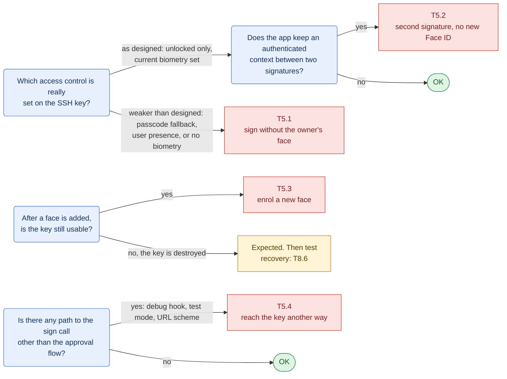

Other keys and data:

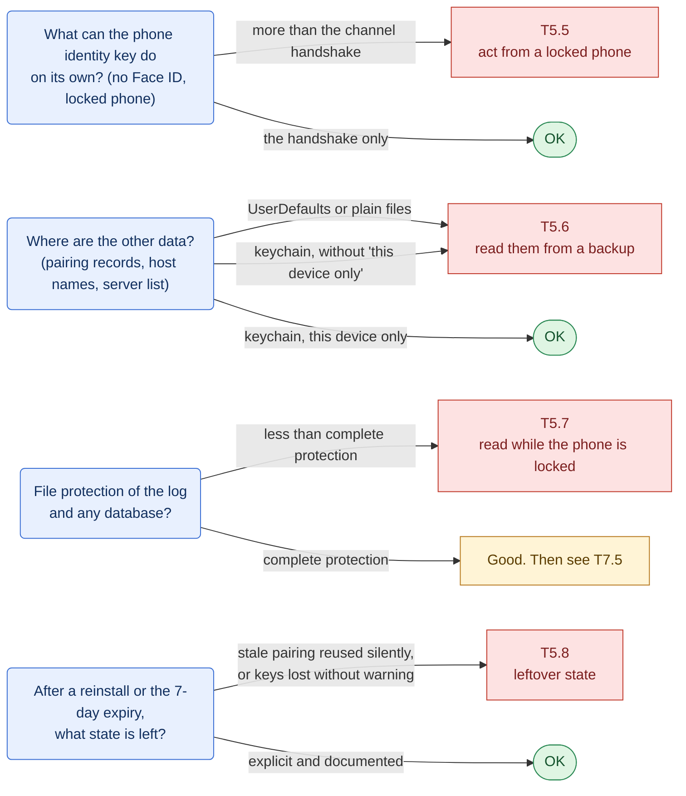

| ID | STRIDE | Attack |
|---|---|---|
| T5.1 | E | As AT4 knowing the passcode, try to sign: fail Face ID until the system offers the passcode. Expected with `biometryCurrentSet`: no fallback. |
| T5.2 | E | Approve one request, then send a second immediately. Expected: a new Face ID. Same test as T4.11, seen from the key. |
| T5.3 | E | As AT4 with the passcode, enrol a new face, then sign. Expected: the key is destroyed. |
| T5.4 | E | Look for any way to call the signing code without the approval screen: debug menus, test flags, URL schemes, notification actions. |
| T5.5 | E | List what the phone does after a successful handshake and before any Face ID. Anything beyond receiving requests is done on the authority of a key that works on a locked phone. |
| T5.6 | I | Read pairing records, host names and the server list from a device backup or after migration to another phone. |
| T5.7 | I | Read the log or database while the phone is locked. |
| T5.8 | S, D | Reinstall the app, let it expire, delete it. Look for a stale pairing that is still accepted, or keys that vanish with no warning and no recovery path. |

### T6. Mac agent

Socket and configuration:

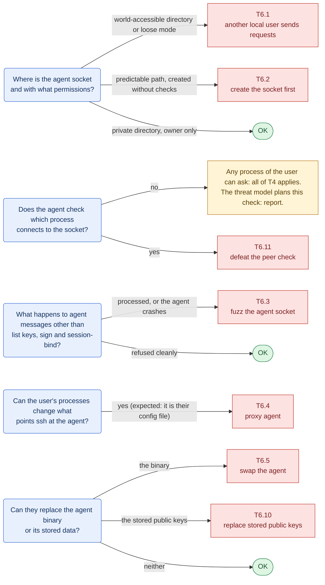

Identity key, forwarding and fallback:

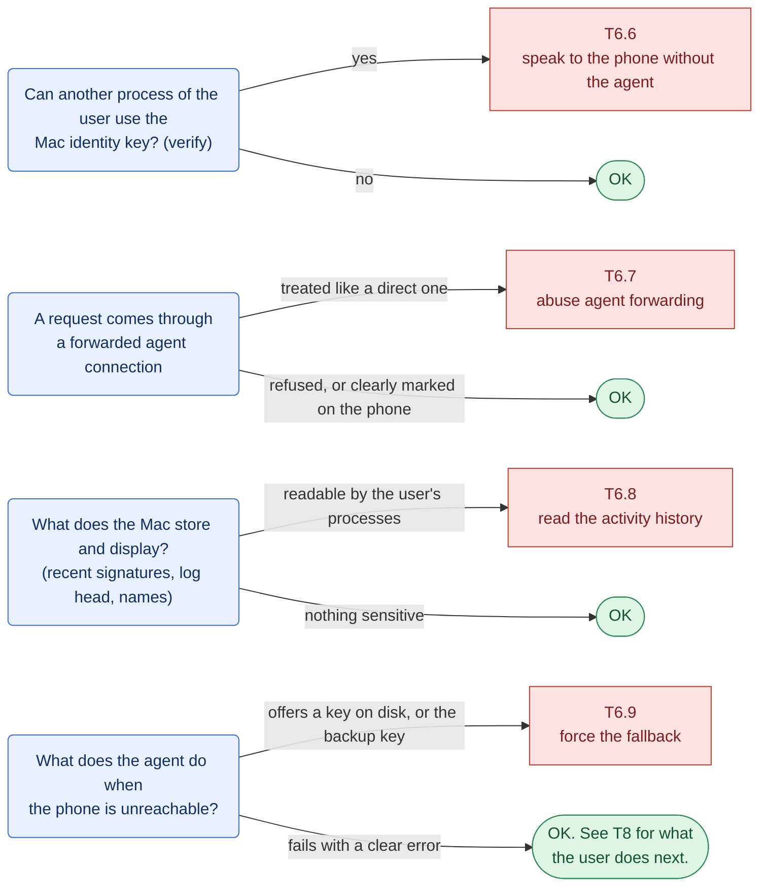

| ID | STRIDE | Attack |
|---|---|---|
| T6.1 | E | Send requests to the socket from another local user account. |
| T6.2 | S | Create the socket path before the agent does and impersonate the agent. |
| T6.3 | T, D | Send the agent every other ssh-agent message (add key, remove key, lock, unknown extension), then oversized and truncated ones. Expected: refused, no crash, nothing forwarded to the phone. |
| T6.4 | S, I | As AT1, edit `IdentityAgent` in `~/.ssh/config` (or `SSH_AUTH_SOCK`) to point at our own agent, which relays to the real one. Record every request, strip the bind (T4.2), inject requests (T4.10). |
| T6.5 | T | Replace the agent binary. Record what the phone can and cannot detect, and whether the new binary can still use the Mac identity key. |
| T6.6 | S | As AT1, use the Mac identity key from our own process and run the channel handshake ourselves. Gains nothing on Face ID, but bypasses the agent's queue, the menu bar history and the log head check. **[verify]** whether a Secure Enclave key of a non-sandboxed app signed with a Personal Team is usable by other processes. |
| T6.7 | E | As AT6, with `ssh -A` in use, request signatures for other hosts while the user is connected. The bind carries a forwarding flag: check that the phone uses it. **[verify]** |
| T6.8 | I | As AT1, read what the Mac keeps: recent signatures, host names, the log viewer's data. |
| T6.9 | E | Make the phone unreachable and see what the Mac offers. Any key on disk voids the model. |
| T6.11 | S | If the agent only serves approved programs: connect through one of them (run the real `ssh` with our own options, a renamed copy, or a script the approved program executes) and check whether the request is accepted as legitimate. |
| T6.10 | S | As AT1, replace the phone's stored identity public key (our phone becomes "the phone"), or the SSH public key the Mac displays (the user installs ours on the next server). |

### T7. Decision log

Design: each entry holds the time, the host-key fingerprint, the user name, the decision and the hash of the previous entry. The latest head and counter are mirrored on the Mac and compared on reconnect.

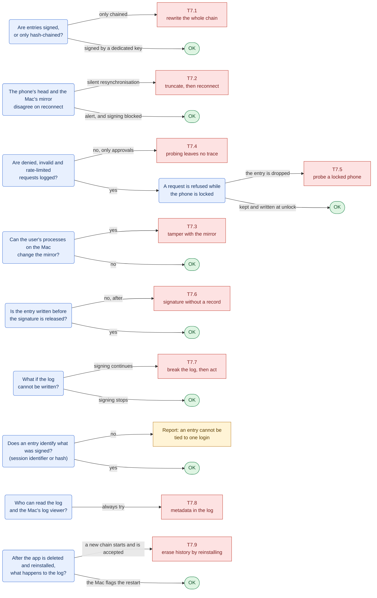

| ID | STRIDE | Attack |
|---|---|---|
| T7.1 | T, R | With write access to the app's storage, rewrite entries and recompute every hash. Without a signature, the chain alone proves nothing: only the mirror does. |
| T7.2 | R | Delete the last entries on the phone, reconnect, and watch what both sides do about the mismatch. |
| T7.3 | T, D | As AT1, change the mirrored head or counter. Either the phone raises a false alarm and blocks (denial of service), or it trusts the Mac's copy (history rewritten from the Mac). |
| T7.4 | R | Send requests that get denied and check that each is recorded. |
| T7.5 | R | Send requests while the phone is locked. The log has complete file protection, so it cannot be written then. Check whether those entries are lost. **[verify]** |
| T7.6 | R | Interrupt between signature and log write: kill the app, drop the link. |
| T7.7 | R | Fill or corrupt the log, then act unrecorded. |
| T7.8 | I | List what the log and the Mac's log viewer reveal: user names, fingerprints, times. Personal and infrastructure data (MASVS PRIVACY). |
| T7.9 | R | Delete and reinstall the app, pair again, and compare with the Mac's mirrored head and counter. Expected: the break in the chain is visible and reported, and the old entries are not silently forgotten. |

### T8. Availability and recovery

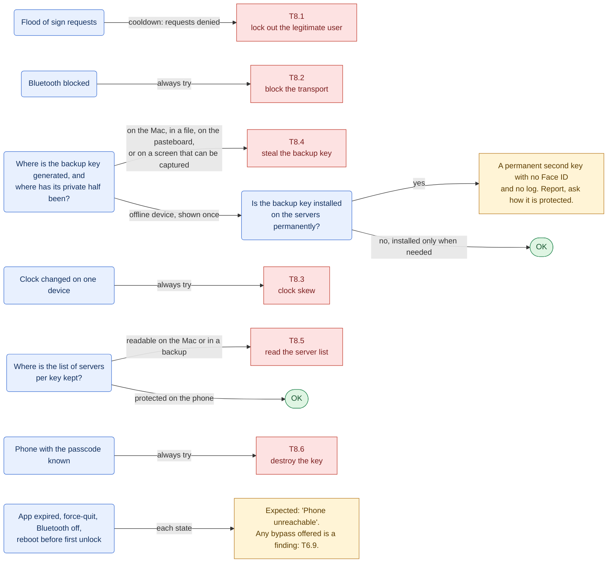

| ID | STRIDE | Attack |
|---|---|---|
| T8.1 | D | As AT1, send requests until the phone enters its cooldown. The design denies new requests during it, so the user is locked out for as long as we keep going. Measure the limit and the cooldown. |
| T8.2 | D | Hold the connection from another device, flood the phone with writes (T3.1), or jam. Check whether the user can still work, and what they are offered instead. |
| T8.3 | D | Change the time on one device. Check whether all requests are rejected and whether the error is understandable. |
| T8.4 | I, E | Follow the backup key from creation to storage. If its private half ever existed on the Mac, AT1 can have it, and the claim "nothing on the Mac to steal" is false for that key. |
| T8.5 | I | Find the list of servers each key is installed on. It is a map of what to attack. |
| T8.6 | D | As AT4 with the passcode, add a face. The SSH key is destroyed by design. Check that the user is told, and how long recovery takes. |

### T9. Platform hygiene (MASVS checklist items)

A checklist, not a tree: run every line.

| ID | STRIDE | Area | Check |
|---|---|---|---|
| T9.1 | I | Console and system logs | Run a full session with Console.app open on both devices. Search for keys, nonces, host names, user names. The design allows fingerprints only. |
| T9.2 | I | Notification on the lock screen | The prompt shows a server and a user name. Is it readable on a locked phone by whoever picks it up? |
| T9.3 | I | App switcher snapshot | Background the app on a sensitive screen. Is the preview masked? |
| T9.4 | I | Pasteboard | Is anything copied (SSH public key, fingerprints, backup key)? Local only, with expiry? |
| T9.5 | I | Screenshots and recording | Is the pairing QR, the backup key or an approval screen capturable? |
| T9.6 | | Permissions | The design needs Bluetooth, Face ID and camera only. Is anything else requested? When? |
| T9.7 | E | URL schemes, notification actions | Can another app, or a notification action, open SentryKey straight into an approval or a pairing? |
| T9.8 | E | Debug leftovers | Test hosts, bypass flags, verbose modes, "unverified" mode still reachable in the J4 build. |
| T9.9 | T | Dependencies | The design says Apple frameworks only. Is that still true? |
| T9.10 | I | Secrets in the repository | Gitleaks runs in CI. Check that it actually ran on the audited commit. |
| T9.11 | | Jailbroken or debugged device | Does the app notice? Low priority, but MASVS RESILIENCE asks the question. |

## 4. State matrix

Run the same `ssh` command in each combination and record what happened. Expected outcomes come from `docs/ARCHITECTURE.md` where it states them. The others, marked *(proposal)*, are for the team to decide.

| # | iPhone state | Mac state | Expected outcome |
|---|---|---|---|
| S1 | Unlocked, app in foreground | Unlocked | Prompt in the app, Face ID, signature |
| S2 | Unlocked, app in background | Unlocked | Notification, tap, Face ID, signature |
| S3 | Locked, app in background | Unlocked | Notification on the lock screen. Nothing signed before unlock and Face ID |
| S4 | Rebooted, never unlocked | Unlocked | "Phone unreachable: open SentryKey" |
| S5 | App force-quit | Unlocked | "Phone unreachable: open SentryKey" |
| S6 | Bluetooth off, Airplane Mode, or out of range | Unlocked | "Phone unreachable". No fallback key |
| S7 | Any | Locked or asleep, request from a background job | Prompt appears with nobody at the Mac. Deny is the user's job *(proposal: mark it on the prompt)* |
| S8 | Prompt shown, not answered for 60 s | Any | Mac fails the request. A later tap signs nothing |
| S9 | Two requests within a second | Any | Two distinct prompts, one Face ID each |
| S10 | Paired with two Macs, both sending | Both | Each prompt names its Mac *(proposal)* |
| S11 | Any | Agent restarted mid-request | New handshake. The pending request is gone |
| S12 | App restarted mid-session | Any | New handshake, new keys and counters |
| S13 | Clock off by 10 minutes | Any | Rejected with a clear message *(proposal)* |
| S14 | Face enrolment changed | Any | SSH key destroyed, recovery flow starts |
| S15 | App re-run from Xcode after expiry | Any | Keys kept, no re-pairing |
| S16 | App deleted and reinstalled | Any | Keys gone, explicit re-pairing, old pairing refused |
| S17 | In cooldown after too many prompts | Any | Denied, logged, and the user is told why |
| S18 | `ssh` older than 8.9 (no session-bind) | Any | J3: signed as "unverified". J4: denied |

## 5. What to test at each milestone

| Milestone | State of the design | Red team focus |
|---|---|---|
| J1, J2 | No code | Walk every tree as a design review. Each question the team cannot answer, and each item of section 7, goes into the STRIDE model. |
| J3 MVP | Pairing, channel, Face ID signing. Host reported by the Mac and labelled "unverified" | T1, T2, T3, T5, and in T4 everything except host verification. T4.1 is expected to succeed: check the label and record the accepted risk. |
| J4 hardening | Session-bind verified on the phone, log with mirrored head, rate limit, backup key | T4.2 to T4.9, T7, T8, and T9.8 (the "unverified" mode must be gone). Then the full list again as regression. |
| Stretch | Git commit signing, Mac proximity lock | T4.6 for the `git` namespace, T3.10. |

Suggested order inside a milestone: T4, T5, T1, T2, T3, T6, T7, T8, T9.

## 6. From tree to finding

The brief's loop is specify, generate, review, test, attack. A finding at the attack step sends the function back to the specification step.

From J3, turn each red box into a test and write up the ones that succeed:

```markdown
### F-XXX · Short title

- **Tree reference:** T4.7
- **STRIDE:** S
- **MASVS domain:** AUTH
- **Attacker:** AT1
- **Build:** commit, iOS version, macOS version, OpenSSH version
- **Preconditions:**
- **Steps to reproduce:**
- **Observed result:**
- **Expected result:**
- **Impact:** which asset (AS1 to AS8), and what the attacker gains
- **Suggested fix:**
- **Status:** Open / Fixed in PR # / Accepted risk, and who accepted it
```

## 7. Questions the design leaves open

Found while aligning this guide with `docs/ARCHITECTURE.md`. Each is a proposal for the team to answer in the architecture document or the threat model, not a confirmed flaw.

1. **Who names a server on first use?** The phone verifies the host key, but a fingerprint means nothing to a user. If the name comes from the Mac, malware can name a production server "github.com" the first time it is seen (T4.7).
2. **Where does the backup key's private half exist, even briefly?** If it is generated on the Mac, the design's main claim does not hold for that key (T8.4). If it stays installed on every server, it is a permanent way in with no Face ID and no log.
3. **Anything a stranger's Bluetooth device can trigger.** The phone's characteristic is writable before the handshake. The wake-up, the frame parser and the handshake parser are exposed to anyone in range (T3.1 to T3.3).
4. **The cooldown is a lockout.** The rate limit that stops prompt flooding also lets malware on the Mac keep the user out of every server (T8.1).
5. **Requests refused while the phone is locked may not be logged,** because the log file cannot be written then (T7.5).
6. **Are log entries signed?** The architecture describes a hash chain and a mirrored head, not a signature. The mirror lives on the machine assumed to be compromised (T7.1, T7.3).
7. **One Face ID, one signature** is stated as a property. It depends on how the authentication context is handled in code and needs a test of its own (T4.11).
8. **Agent forwarding.** The architecture does not say what the phone does with a forwarded request (T6.7).
9. **Which Mac is asking?** One key can serve several Macs, so the prompt should name the Mac (T4.9, S10).
10. **The notification is visible on the lock screen** with a server and a user name (T9.2).
11. **`docs/THREAT_MODEL.md` and `docs/ARCHITECTURE.md` describe different designs.** The threat model plans per-host policy, session approval, proximity, Face ID only for anomalies, fingerprint comparison at pairing and a signed log. The architecture has none of these. The threat model also lacks the assumption the architecture asks it to state: the Mac is not compromised at pairing time. One of the two documents needs updating before J1 is closed.
12. **Checking which local process talks to the agent** is planned in the threat model and absent from the architecture (T6.11).
